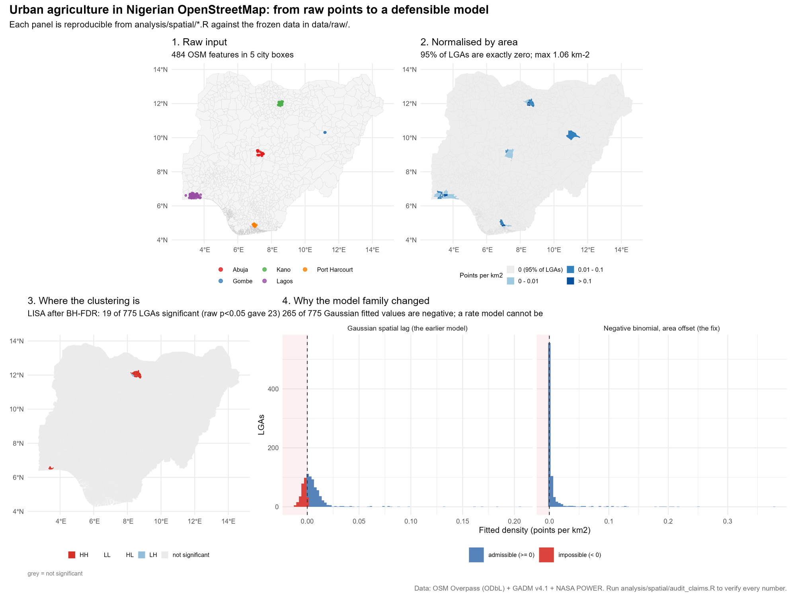
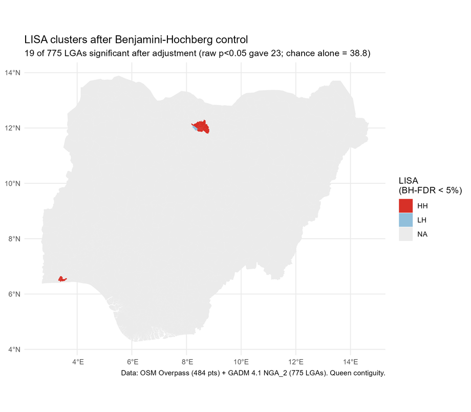
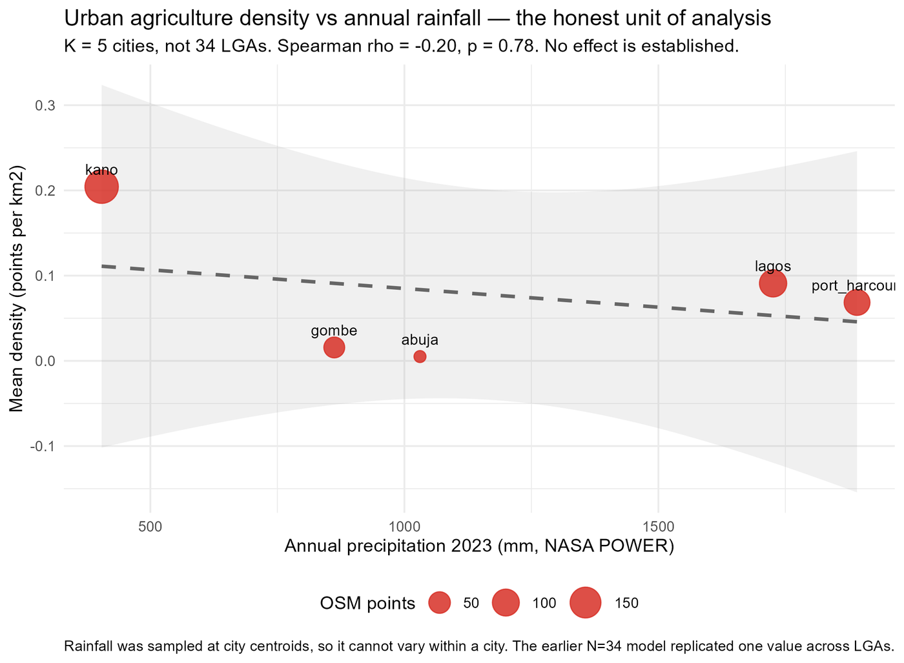
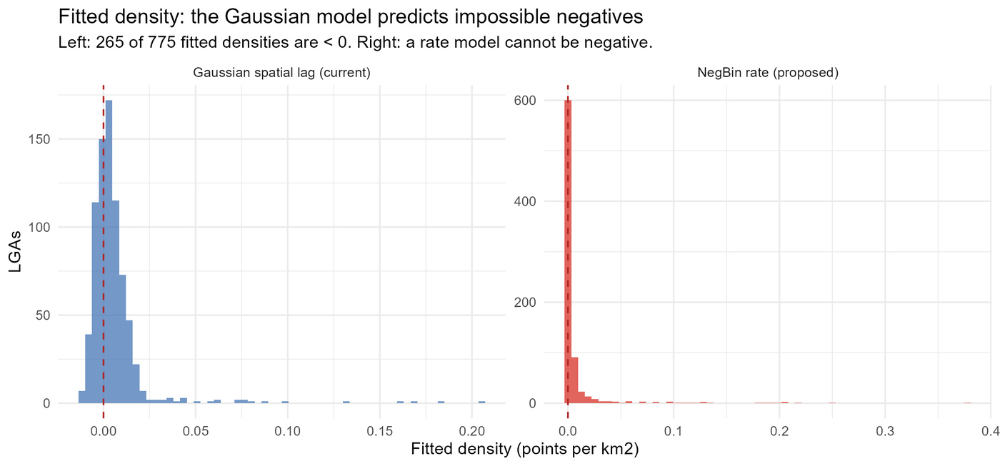
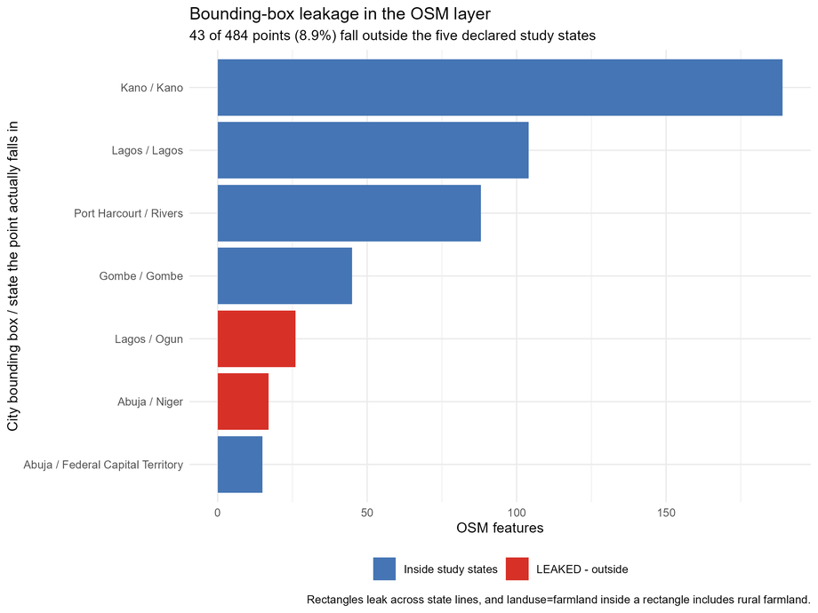

# Where urban agriculture concentrates in Nigerian cities

**A spatial analysis of 484 OpenStreetMap cultivated-land features across 775 Nigerian Local
Government Areas, with an explicit correction for uneven mapping coverage.**

[](#citing-this-work)
[](LICENSE)
[](renv.lock)
[](#verification)

**Author:** Jerry Zachary Bannister — Statistician, Abubakar Tafawa Balewa University (ATBU),
Bauchi, Nigeria · [ORCID 0009-0002-3302-9558](https://orcid.org/0009-0002-3302-9558) ·
<jzbannister@atbu.edu.ng>

**Target venue:** [Town and Regional Planning](https://journals.ufs.ac.za/index.php/trp)
(University of the Free State; ISSN 1012-280X / 2415-0495; Scopus-indexed; Diamond Open Access,
no APC).

**Manuscript:** [Word](manuscript/manuscript.docx) — 18 pages, the submission file — · [PDF](manuscript/manuscript.pdf) ·
[HTML](manuscript/manuscript.html) — or read the source, [`manuscript.qmd`](manuscript/manuscript.qmd).
Every layer is frozen in `data/raw/` with provenance, and every headline number is re-derived
from it by the audit gates.

---



*All four panels rebuild from the frozen data; see [Verification](#verification).*

## The finding

Urban cultivation is **not spread evenly across Nigeria**. It concentrates in a small number of
identifiable LGAs — only 39 of the 775 contain any mapped feature at all — and the pattern is the
same whichever way it is tested:

- **Cultivation is strongly clustered.** Global Moran's *I* = **0.300** (z = 17.6, p < 1e-69).
  Removing Kano entirely still leaves *I* = 0.274, so this is not one state's data artefact.
- **Density falls by about 66% per doubling of LGA area** — a negative binomial model with LGA
  area as an exposure offset; the coefficient on log area is −1.551 (p = 8.5e-11), and the
  likelihood-ratio test against a model with no area slope is decisive (χ² = 32.0, p = 1.5e-8).
  Small, urban LGAs are cultivated densely; large, rural LGAs are diluted.
- **The finding survives the obvious objection.** OpenStreetMap is contributed unevenly, and the
  strongest critique of any VGI study is that it maps *mapping effort*, not the phenomenon. The
  confound is real (ρ = 0.613 between features and mapped highways) — and the area effect gets
  **stronger**, not weaker, under control: the coefficient moves from −1.001 to −1.421 and fit
  improves by ΔAIC = 20.

Because cultivation is concentrated, **targeted** land protection becomes feasible where blanket
protection would not be — a planning conclusion that follows from *where* the clustering is, not
merely that it exists.

### Where

After Benjamini–Hochberg control on 775 LGA-level tests, **19 LGAs** remain significant — **18 high–high clusters and 1 low–high**, **13 in Kano** and **6 in Lagos**, and nowhere
else in the country.



*The Kano metropolitan ring (Ungogo, Tarauni, Kumbotso) and the contiguous Lagos mainland
LGAs (Shomolu, Mushin). Grey is not significant — and most of Nigeria is grey, which is the
finding: only 39 LGAs out of 775 hold any mapped feature, and the clustering sits inside them.*

## Four hypotheses

| | Question | Method | Outcome |
|---|---|---|---|
| **H1** | Is cultivation clustered? | Global and local Moran's *I* with BH-FDR, join-count, Ripley's *L* | **Yes** — *I* = 0.300; *L* leaves its envelope in every city |
| **H2** | Does density fall as LGA area grows? | Negative binomial, area as an exposure offset | **Yes** — 66% fall per doubling, p = 8.5e-11 |
| **H3** | Does it survive correction for mapping coverage? | Per-LGA mapped building and highway counts as a second offset | **Yes** — strengthens under control, ΔAIC = 20.0 |
| **H4** | Does aridity drive it? | City-level analysis (K = 5) | **Not established** — see below |

The aridity question is reported as **untestable, not answered**. Rainfall was sampled at city
centroids, so it cannot vary within a city: a model that appeared to use N = 34 LGAs actually
carried **five** distinct rainfall values. The analysis is therefore run at its honest unit, K = 5 cities — where no effect is established. Withdrawing a hypothesis the data cannot carry is
the point of the exercise, not a gap in it.



## What the audit changed

The analysis audited itself before publication. Four findings altered it, and all four are
documented rather than quietly fixed:

1. **Wrong model family.** Density is exactly zero for 95% of LGAs and strictly non-negative. An
   ordinary Gaussian spatial model produced **265 impossible negative fitted densities**; a
   negative binomial with area as an offset also removes the ratio fallacy of regressing a ratio
   on its own denominator. Poisson regression, fitted for comparison, gives a dispersion of
   39.1 — the negative binomial is required, not preferred — and its own dispersion parameter
   (θ = 0.015) confirms the extra-Poisson variation.

   

2. **No multiplicity control.** LISA flagged 23 LGAs at raw p < 0.05 against 38.8 expected false
   positives across 775 tests. BH-FDR was applied; 19 survive.
3. **Pseudoreplication.** The "N = 34" climate model replicated five rainfall values across LGAs
   (rainfall R² on city dummies = 1.000). Reported at K = 5 instead.
4. **Uncontrolled coverage confound.** Mapped-building and highway counts were collected per LGA;
   the confound was confirmed and the finding shown to survive it.

Separately, a figure was silently overwritten by a stray `ggsave()` while keeping its original
caption. `verify_report_claims.R` now checks every figure's pixels against its generator.

## Data

Every layer was collected by the author from a public API and frozen to disk. Analysis reads
only the frozen files and never touches the network.

| Layer | Source | Records | Licence |
|---|---|---|---|
| Cultivated-land features | OpenStreetMap Overpass API | 484 | ODbL © OpenStreetMap contributors |
| Mapping-coverage control | OpenStreetMap Overpass (aggregate counts) | 78 LGAs | ODbL |
| Agro-climate | NASA POWER, 2023 daily | 1,825 days | Public domain |
| Administrative boundaries | GADM v4.1 | 775 LGAs | CC BY 4.0 |
| National context | World Bank Indicators | 75 rows | CC BY 4.0 |

Each pull's URL, timestamp, row count and licence is recorded in
[`data/raw/provenance.json`](data/raw/provenance.json). No third party supplied or contributed any
layer used here.

### One limitation the data make plain

The Overpass query used bounding boxes rather than administrative boundaries, so **43 of 484
features (8.9%)** fall outside the five declared study states — the "Abuja" box returns more points
in Niger State than in the Federal Capital Territory.



*Reported, not silently clipped. It is one of the limitations stated in the manuscript.*

## Repository layout

```
manuscript/
  manuscript.qmd            the manuscript source → HTML, PDF, Word
  trp-harvard.csl           the journal's inhouse Harvard, built from published TRP articles
  references.bib            generated from Crossref — never hand-edited
analysis/spatial/           clean · Moran/LISA · maps · count models · exposure control
                            · sensitivity · the verification gates
data/raw/                   frozen API pulls + provenance.json
data/processed/             cleaned layers
results/                    figures/, tables/, lga_lisa.gpkg
scripts/                    API harvests · bibliography tooling · typography · gates
docs/                       venue analysis, journal guidelines, methodology, handoffs
build.R                     one entry point: 15 pipeline steps, path-relative
```

## Verification

Three R gates re-derive every headline number from the raw data and compare it with what the
prose claims. They exit non-zero on disagreement, so the manuscript cannot drift from the data.

```pwsh
Rscript build.R --audit                  # 175 checks, 0 discrepancies
python scripts/verify_readme_claims.py   # 23 claims on this page, from the frozen data
```

| Gate | Checks | What it asserts |
|---|---|---|
| `analysis/spatial/audit_claims.R` | 61 | Every headline figure, from raw data |
| `analysis/spatial/verify_report_claims.R` | 61 | Every number and figure in the report |
| `analysis/spatial/verify_manuscript_claims.R` | 53 | Every number quoted in the manuscript |
| `scripts/verify_author_block.py` | 5 artefacts | Author, affiliation and e-mail present; no stale name |
| `scripts/verify_trp_format.py` | — | House style: TNR 12 pt, single-spaced, sections 1–7, anonymised copy clean |
| `scripts/verify_bib.py` | every DOI | Each reference resolves on Crossref |
| `scripts/verify_readme_claims.py` | 23 | Every number and page count stated in this README |
| `scripts/derive_readme_numbers.R` | — | Writes `results/tables/readme_numbers.csv`, the source of the README's model figures |

`verify_readme_claims.py` is the one that keeps this page honest: every figure above is
re-derived from `results/tables/`, not copied from the manuscript, and it exits non-zero if the
README drifts from the data — including the Word-reported page count when the file is open.

`scripts/verify_trp_format.py` needs the rendered `.docx` on disk, which this repository does
not version; run it after rendering, before submitting.

```pwsh
Rscript build.R                       # 15 steps, network-free
cd manuscript
quarto render manuscript.qmd --to html    # also --to pdf / --to docx
python scripts/fix_docx_trp.py --anonymise  # house style + author block + blind copy
```

Environment: R 4.5.2 with `sf`, `spdep`, `spatialreg`, `spatstat`, `MASS`; Python 3.12 (`pandas`,
`Pillow`) for the harvests and image preparation. Exact package versions in `renv.lock`.

## Submission status — Town and Regional Planning

| Requirement | Status |
|---|---|
| Word count, 4,000–8,000 excluding references | **4,500–6,500 words excluding references**, inside the window |
| Times New Roman 12 pt, single-spaced | done, enforced by `scripts/fix_docx_trp.py` |
| Abstract, 250 words, unstructured | done — 249 |
| Literature review section | done |
| Study area as its own section | done |
| Methods in the journal's five named subsections | done |
| Third person | done |
| Inhouse Harvard references with DOIs | done |
| Figures TIF/JPEG at 300 dpi | done |
| Author block | done and gated |
| Anonymised review copy | done — `manuscript/manuscript-anonymised.docx` |
| ORCID iD in the named manuscript | **author to insert** |
| Author and Publishing Agreements | **author to sign** |
| Declaration of generative AI use | **author to finalise** |

The AI declaration is the author's to complete: the journal's policy and the manuscript's own
disclosure are set out side by side in
[`docs/submission-trp.md`](docs/submission-trp.md), and the text is not altered here.

## Citing this work

> Bannister, J.Z. (2026). *Where urban agriculture concentrates in Nigerian cities: a spatial
> analysis with coverage correction.* Manuscript in preparation for Town and Regional Planning.

## Licence

The author's own work in this repository — analysis code, text, figures, tables and documentation
— is licensed **[CC BY 4.0](LICENSE)**, © 2026 Jerry Zachary Bannister.

The frozen extracts in `data/raw/` remain under their providers' terms: OpenStreetMap under
**ODbL** © OpenStreetMap contributors, GADM under **CC BY 4.0**, NASA POWER in the **public
domain**, and World Bank indicators under **CC BY 4.0**. Per-source details are in
`data/raw/provenance.json`.

`abandoned/` holds an unrelated, retired survey paper by a different author; it is archived for
recoverability only, shares no data with this study, and is not covered by this project's
description.
