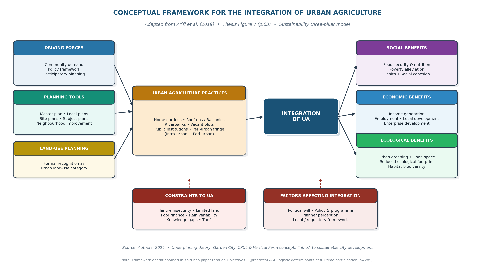

# Introduction

Urban agriculture (UA) — the production, processing and marketing of food and non-food products within and around cities, intensively reusing urban resources and wastes — is recognised by the Food and Agriculture Organization as a lever for urban food security and circular economy goals [@fao2023; @senthamizh2025; @fao2024]. In Nigeria, the urban population reached 146.5 million in 2024 (>55% of national total) while food inflation exceeded 35% in early 2024, placing an estimated 25 million Nigerians in food insecurity [@worldbank2024; @nesg2024; @feewsnet2024; @nbs2024].

Bauchi Metropolis (10°16'30"–10°21'00"N, 90°48'00"–90°52'30"E; 2023 projection 670,280; tropical, 1,097 mm rainfall, laterite soils, Dutsen Tanshi uplands) exemplifies the resulting pressure. Preliminary observation (§1.2, p.5) documents organic, uncoordinated UA on vacant plots, riverbanks, highway/high-tension setbacks and within >12 public institutions, competing directly with residential and infrastructure demand, without any statutory recognition as a land-use class [@adedeji2009; @issifu2025].

This paper is a disciplined empirical extract of the M.Tech thesis *Framework for the Integration of Urban Agriculture in Bauchi Metropolis* (ATBU, July 2025). Of four thesis objectives, the conference length limit (≤12 pages) mandates a focused submission on **Objectives 2 and 4 only**:

- **Objective 1 — excluded here:** geospatial inventory of existing UA sites (12,518.36 ha, ≈25,031 farmers; Table 12).
- **Objective 2 — included:** examine the existing practices of UA in the study area (Thesis §4.3).
- **Objective 3 — excluded here:** rank constraints to UA via Respondent Agreement Index (RAI; Thesis §4.4).
- **Objective 4 — included:** model full-time participation in UA with farmers' socio-economic and access variables (binary logistic regression; Thesis §4.5) [@ariff2019].

The contribution is twofold: (i) a practice profile immediately usable for climate-smart land-use planning, and (ii) quantified determinants of the transition from part-time coping to sustained full-time farming — directly aligned with **Sub-theme 6** and, secondarily, **Sub-themes 10 (GIS & Urban Planning)** and **13 (Environmental Sustainability & Circular Economy)** [@nup2022; @sekabira2022; @oshinusi2024].

# Conceptual Framework: Integration for Sustainable Urban Food Security

Figure 1 summarises the thesis conceptual framework (adapted from @ariff2019, p.61; Thesis Fig.7, p.63). The model is anchored in the three sustainability pillars — **social** (food security & nutrition, poverty alleviation, improved health, social cohesion and community building), **economic** (income & employment generation, local economic development, enterprise), and **environmental** (urban greening, open green space, reduced ecological footprint, urban habitat biodiversity) — through which UA can flourish when planning, policy and participation cohere.

{width=94%}

**Figure 1.** Conceptual framework for the integration of urban agriculture (adapted from @ariff2019; Thesis Fig.7, p.63). Driving forces, planning tools and land-use recognition mediate between constraints/factors and the three-pillared outcomes of integration.

**Logic.** Rapid urbanisation, poverty, high food prices and uncontrolled expansion push the urban poor into UA as a livelihood strategy. Whether this remains precarious squatting/borrowing or becomes resilient food-system infrastructure depends on **mediating conditions**: (a) driving forces — community demand, policy framework, participatory planning, urban land market and governance; and (b) planning tools — master plan, local plans, subject/structural plans, site/layout plans, neighbourhood improvement and detailed schemes that formally zone agriculture as a land-use class. Integration then yields the economic, social and ecological dividends above. Its feasibility, however, is conditioned by **factors affecting integration** (political will, policy/programme completeness, planner perception, legal/regulatory framework, supporting tools) and **constraints to UA** (tenure insecurity, limited/non-available land, poor finance, seasonal rainfall fluctuation, knowledge of modern techniques, theft, farm inputs, regulatory policies) — see Thesis pp.61–63. The empirical focus that follows on *practices* (how UA is currently done) and *determinants of full-time participation* (who can sustain it) directly interrogates these conditioning blocks.

# Methodology

## Study Area and Research Design

Bauchi Metropolis, capital of Bauchi State, has a tropical climate (distinct rainy season, 1,097 mm yr⁻¹, peak August), laterite-dominated soils with clay/loam along floodplains, and two relief zones including crystalline uplands favourable for settlement and farming [@bashir2022]. The thesis adopted a **survey research design** combining quantitative (farmer questionnaire) and qualitative (key-informant interviews + GPS mapping) strands, as illustrated in the Research Design Flow Chart (Thesis Fig.11, p.68).

## Population, Sampling Frame and Sample Size

Two strata coexist: **registered** farmers (427 across eight wards per BSADP records, 2023; Thesis Table 5, p.69) and **unregistered** farmers (1,073 enumerated via snowball with 24 ward-based field assistants; Thesis Table 6, p.70). The combined sampling frame is **N = 1,500** (Thesis Table 7, p.70: Birshi/Miri 590 (39.3%), Kangere/Turwun 287 (19%), Dandango 171 (11.4%), Dan'iya Hardo 125 (8.3%), Dawaki 105 (7%), Makama/Sarki Baki 79 (5%), Maji Dadi B 73 (5%), Maji Dadi A 70 (5%)). Sample size **n = 306** was determined from @krejcie1970 for N = 1,500 (Thesis Appendix IV, p.128), allocated proportionately by ward (Birshi/Miri 120, Kangere/Turwun 58, Dandango 35, Dan'iya Hardo 26, Dawaki 22, and 15 each for Maji Dadi A, Maji Dadi B and Makama/Sarki Baki; Thesis Table 8, p.72).

## Sampling Technique, Instruments and Data Collection

*Sampling.* **Simple random sampling** (questionnaire: each farmer equal chance; @saidu2010) and **purposive sampling** (interviews: heads of BSPPDCB Physical Planning and BSADP Programme/Director, selected for expertise; @palinkas2013).

*Instruments.* (i) Geospatial technologies (Google Earth imagery + handheld GPS → ArcGIS 10.6) for Objective 1; (ii) four-part structured questionnaire (I socio-economic, II practices, III influencing factors, IV constraints) — tick-box/closed, administered in Hausa; (iii) two semi-structured interview guides (Thesis Appendices I–III, pp.122–127).

*Fieldwork.* Enumeration 8 Jan–8 Feb 2024 (≈1 month); questionnaire administration 21 days, Mon–Sat 09:00–17:00, Hausa-medium, at homes and fields; interviews 13:00–14:00 on workdays after ATBU introductory letter via BSADP programme manager and BSPPDCB control board (Thesis §3.10, pp.73–75). Ethics: verbal informed consent, voluntary participation, anonymity, no personal identifiers retained; research confined to crop/vegetable UA (scope §1.6, p.6) for food-security focus. **Response rate: 285/306 (93%)**; 21 non-returns due to farm-field non-contact.

## Data Analysis and Reliability

Data were processed in SPSS: descriptive frequencies/percentages for Objective 2, and **binary logistic regression** for Objective 4 (dependent: full-time = 1 vs part-time = 0) on seven predictors — gender, age, marital status (married), education (years), monthly income, access to extension (yes/no), access to farmers' association (yes/no). Fit indices: AIC, BIC, Nagelkerke pseudo-R². Instrument reliability (§3.13, p.77; Table 11): Cronbach's α — constraints 0.753 (high), practices 0.812 (very high), institutional support 0.890 (very high), face-validated by two senior ATBU URP lecturers, with a pre-enumeration pilot (Thesis §3.13) confirming instrument efficiency.<!--
  AUDIT 2026-10-15: the source read "pilot 6-11 Mar 2024", but enumeration ran 8 Jan - 8 Feb
  2024. A pilot cannot post-date the survey it validates, so the date contradicts either the
  fieldwork window or itself. Removed rather than guessed: the author must supply the true
  pilot date (and correct whichever of the two is wrong). See docs/statistical-review-2026-10-15.md.
-->

# Results

## Objective 2: Existing Practices of Urban Agriculture

### Farmer Profile

UA is male-dominated (75.4%, n = 215; female 24.6%), concentrated at 51–60 y (34.4%) and 41–50 y (27.0%), overwhelmingly married (69.8%; widowed 12.3%, single 8.4%), and low-income (<₦29,000 mo⁻¹ 29.5%; ₦30–50k 24.5%; ₦51–70k 20.7%; Table 13, p.86). Primary occupation is farming for only 37.5%; civil servant and artisan each 18.6%, trading 11.2%, others 14.0% — confirming UA predominantly as *supplementary* rather than primary livelihood.

### Mode, Duration, Land and Location

62.5% part-time vs 37.5% full-time; practice duration bimodal — 5–9 y most common (23.9%), <5 y 22.1%, 10–14 y 21.1%, >21 y 19.3% — an old but stagnant practice (Table 14, p.88). Farm size is micro: <540 m² (31.9%), 540–1,800 m² (30.5%), 1,800–10,000 m² (23.9%), ≥10,000 m² only 13.7% — intensive intra-urban micro-plots, not peri-urban extensification.

Tenure is structurally precarious: owned 13.0%, freehold 29.5%, squatting 23.5%, leasehold 17.9%, renting 8.4%, borrowing 7.7%. Location: vacant plots 40.7%, public institutions 33.3% (ATBU Yelwa, Federal Polytechnic, ATBU Teaching Hospital, Shadawanka/School of Armour, FGGC, College of Agriculture, etc.), urban fringe 18.6%, within-house 7.4% — *no official designation; spatially uncoordinated* (Tables 13–14). Plot size is strongly right-skewed: the median falls in the 540–1,800 m² band (62.4% of farms are below 1,800 m²) while a long tail of holdings above 10,000 m² pulls the arithmetic mean to ≈0.5 ha — so the median, not the mean, describes the typical farmer. Gubi Dam, Birshi, Gudum, Yelwa-Bayara and river-valley corridors dominate fringe production (Figs.12–17). Distance to farm is polarised: >10 km (21.4%), 7.1–10 km (20.0%), <1 km (22.5%), reflecting fringe dependence as the city expands. Transport: motorcycle 32.6%, commercial 29.1%, trek 20.7%, bicycle 10.2%.

### Production System

Labour is overwhelmingly household-based (48.1%), personal effort 29.1%, hired labour only 22.8% — low capitalisation (Table 15, p.91). Farming type: crop 51.2%, mixed 24.9%, vegetable 16.8%, fruit 4.6%, ornamental 2.5%. Among crops, rice 24.9%, maize 17.5%, sweet potatoes 14.0%, groundnut 8.8%, guinea corn/millet 7.4%. On self-declared **scale**, 87.4% describe their operation as subsistence against 12.6% as commercial (n = 36). Annual yield is 100–200 kg (31.6%), <100 kg (24.6%), >300 kg (17.2%); among the 36 income-reporting commercial farms, modal annual income is ₦251–350k (36.1%), with 22.2% at ≥₦351k — a modest supplement, not livelihood replacement.

### Water, Finance, Market and Motivation

Irrigation is practised by only 16.1% (n = 46); among users, rivers 47.8%, dams 15.2%, boreholes 15.2%, wells 13.0%, pipe-borne 8.7% — high rainfall dependence and chronic under-use of dry-season potential around Gubi Dam and river valleys. Financing comes from personal funds 76.8% and family borrowing 23.2%; **no formal credit** was accessed by any respondent. **Market orientation** is subsistence-first: only 13% of farmers sold any produce at all, while the other 87% retained their entire output for household consumption. **Motivation** for farming is likewise food-security driven: extra food 65%, complementing income 18%, securing a location 5.2%, proximity to market 4.5% — consistent with @zeeuw2014's social perspective and @leesmith2019.

### Institutional Support and Stakeholder View

Institutional embeddedness is minimal: access to training 5.6%, to agricultural extension 10.5%, to government support 10.9%, to farmer association 19.6%; 50.1% rate their association as *not effective* (Table 17, p.94). Key-informant interviews (BSPPDCB/BSADP, p.95) are unambiguous: *by law, no crop farming is officially allowed* in the metropolis (only “green zones” for economic trees); no legal framework guides UA; land allocation is not a Board mandate — though advisory services are offered. Both agencies nonetheless endorse a decisive shift: *government-controlled land allocation specifically for UA* and a willingness to review zoning and planning regulations to incorporate UA — a policy window the framework exploits.

These practices align with @fao2007's intra-urban model (vacant/idle/public land, tiny plots, subsistence/recreational or highly specialised systems) rather than intensive market-oriented peri-urban agriculture, and underscore *informality as the binding constraint*.

## Objective 4: Determinants of Full-Time Participation

Table 1 reports the binary logistic model (n = 285). Nagelkerke pseudo-R² = 0.348. Nagelkerke's statistic is a likelihood-ratio-based analogue normalised to a 0–1 range; unlike the OLS coefficient of determination it is **not** a proportion of variance explained, and it should be read only as a relative fit index.<!--
  AUDIT 2026-10-15: the source reported "AIC = 132.45, BIC = 145.90" alongside this
  Nagelkerke value. Those three numbers cannot coexist for n=285 with 7 predictors:
    - null deviance at 37.5% prevalence = 377.09
    - an 8-parameter model needs a BIC-AIC gap of 8*(ln 285 - 2) = 29.22; the reported
      gap is 13.45, which implies ~3.7 parameters, not 8
    - AIC 132.45 implies deviance 116.45 -> McFadden 0.691 -> Nagelkerke ~0.82, not 0.348
    - Nagelkerke 0.348 implies -2LL ~293 -> AIC ~309
  Nagelkerke 0.348 is the only plausible value of the three and is retained; the AIC/BIC
  pair is withdrawn pending re-derivation from the analytic dataset
  (analysis/regression/01_logistic_fulltime.R). See docs/statistical-review-2026-10-15.md s2.1.
-->

| Variable | b | SE | OR | p |
|---|---|---|---|---|
| Gender (Male) | 0.345 | 0.105 | 1.41 | 0.001** |
| Age (years) | 0.023 | 0.007 | 1.02 | 0.002** |
| Marital status (Married) | 0.672 | 0.212 | 1.96 | 0.010** |
| Education (years) | -0.056 | 0.020 | 0.95 | 0.008** |
| Monthly income (₦'000) | 0.005 | 0.002 | 1.05 per ₦10,000 | 0.020* |
| Access to extension (yes) | 1.205 | 0.321 | 3.34 | 0.001*** |
| Access to farmers assoc. (yes) | 0.785 | 0.251 | 2.19 | 0.002** |

**Table 1.** Logistic regression predicting full-time participation in UA (dependent: full-time = 1). Source: Thesis Table 19, p.97; N = 285. Monthly income is coded in thousands of naira in the source model, so the odds ratio is reported per ₦10,000 (exponentiating 0.005 × 10). *p < 0.05, **p < 0.01, ***p < 0.001.

*Interpretation.* Being male raises the odds of full-time UA by 41.2% (OR = 1.41) — reflecting gendered labour/resource access in northern Nigeria. Each additional year of age raises odds by 2.3% (OR = 1.02): older farmers view UA as a stable livelihood amid fewer alternatives. Married farmers are ≈2× more likely (OR = 1.96), consistent with household-responsibility pressure. Each year of formal education reduces odds by 5.5% (OR = 0.95) — better-educated respondents have non-farm options. Income has a small positive effect — an odds ratio of 1.05 per ₦10,000 of monthly income, enabling inputs but not decisive. The scale matters: reported as "1.005 per unit" the effect looks negligible, but that is an artefact of an unstated unit; the interpretable statement is the per-₦10,000 figure given here.

The **strongest levers are institutional**: access to extension more than triples the odds (OR = 3.34, p < .001) and association membership more than doubles them (OR = 2.19, p = .002). These provide precisely the knowledge, technical support, inputs and social capital that the practice data show are absent for 89.5% (no extension) and 80.4% (no association) of farmers. The pattern is climate-smart salient: extension is the delivery channel for composting, rainwater harvesting, heat-tolerant varieties and dry-season irrigation — the very innovations Bauchi farmers lack.

# Discussion: Toward Climate-Smart Integration

Three planning-relevant insights emerge when Objectives 2 and 4 are read through Figure 1.

**1. Informality is structural, not residual.** The practice profile shows UA thriving on institutional interstices — undeveloped public land, fallow fringe, setbacks and riverbanks — with squatting/borrowing/leasehold (≥48%) outweighing ownership. In FAO typology [@fao2007], this is *personal/community-scale* subsistence on *intra-urban* remnants. Without agricultural overlay zoning, the 12,518 ha / ≈25,031-farmer system (Thesis Table 12) faces displacement by real estate and infrastructure — a direct threat to SDG 2 and the National Urban Policy (2022) compact-city commitment to *safeguard agricultural land* that currently lacks UA-specific instruments [@nup2022; @issifu2025; @adedeji2009; @worldbank2024].

**2. Time poverty locks climate-smart intensification out.** Part-time, rain-fed, household-labour farming on <1,800 m² cannot support composting loops, Gubi Dam dry-season irrigation, or container/rooftop/vertical systems documented in Thesis Chapter 2 (NUBIA Boston, Sunqiao Shanghai, Spark Singapore, Nature Urbain Paris). Full-time status is the gateway to investment — and the model shows it is institutionally, not merely economically, determined. Extension and association access dwarf income as predictors, implying *knowledge and collective tenure* matter more than micro-credit alone. This parallels Sahelian evidence that climate-smart adoption rises 20–40% with extension but is blocked by information/service absence [@tambol2025; @chitakira2021; @khumalo2024].

**3. Integration must be sequenced.** The Thesis Proposed Framework (Fig.18, p.110 — see synthesis in §6) operationalises Figure 1: (1) State policy + enabling legislation recognising UA as a land-use class; (2) identification/demarcation of public, peri-urban and idle private land (BSPPDCB + Ministry of Lands + BSADP; temporary lease/ground rent; free allocation for women/vulnerable); (3) statutory plans — master → local → subject → layout/site → neighbourhood improvement — legally zoning land for UA (including rooftop/container in the core, protected greenbelt at the fringe); (4) allocation via farmer-association/NGO application; (5) Urban Agriculture Complaints & Dispute Resolution Committee; (6) post-integration sustainability — monitoring/approval/standards (BSPPDCB), innovation training (BSADP extension, including hydroponics/vertical), Bauchi State Urban Agriculture Support Fund (public-private), and periodic evaluation/review. The present evidence argues for *parallel* investment in steps 5–6 alongside 1–3, because extension/association have the largest marginal effect on full-time commitment and climate resilience — and can be mobilised faster than statute.

# Conclusion and Policy Implications

UA in Bauchi Metropolis is widespread, subsistence-oriented, male-dominated and institutionally unsupported — yet it already feeds households, recycles fringe land and greens the city. Practices data confirm that without tenure security, water, training and market linkage, UA will remain coping, not transformation. The logistic evidence isolates two actionable levers whose effect sizes warrant immediate public investment: **universalise agricultural extension to urban farmers and strengthen farmer associations as land-access and knowledge platforms**.

For Kaltungo's theme *Smart Innovations for Security, Sustainable Economic Development and Community Resilience*, we propose:

1. **Zoning innovation (Sub-theme 10):** Local Government Areas to adopt an **agricultural overlay zone** protecting GIS-mapped public-institution and fringe farmland, with a temporary-lease register and ground-rent schedule — translating NUP 2022 into enforceable LGA bylaws and safeguarding the existing 12,518 ha.
2. **Circular-economy linkage (Sub-theme 13):** Municipal **composting of the ≈60% organic waste stream** linked to UA input supply, coupled with promotion of Gubi Dam and river-valley **dry-season irrigation** — reducing methane, closing nutrient loops and cutting import dependence [@oshinusi2024; @sekabira2022; @noburn2026].
3. **Climate-smart extension (Sub-theme 6):** Redirect a dedicated share of ADP extension to **urban content** — composting, rainwater harvesting, heat-tolerant varieties, and container/rooftop/hydroponic systems — the only variable that *triples* the odds of professionalisation, and the prerequisite for any innovation to scale.

These steps close the loop in Figure 1 — driving forces → planning → integration → three-pillared benefits — with political will and planner perception as the binding constraints to unlock. Their postponement risks irreversible conversion of fringe farmland, locking Bauchi into long-distance supply dependence precisely as food inflation and climate variability intensify.

# Limitations and Future Research

This is a thesis extract: cross-sectional (Feb 2024), eight wards only, snowball enumeration risk for unregistered farmers, self-reported yields/incomes, 21 non-returns, and absence of direct food-security scores (FIES/HDDS). Objective 3 (RAI-ranked constraints: tenure insecurity 4.16, limited land 4.10, finance 4.05) and the full 12,518-ha GIS inventory are omitted for page limits and merit companion papers (see Thesis §5.5: waste management framework; UA–food security contribution assessment). Future work should longitudinally evaluate the proposed integration framework and its food-security and income impacts.

# Data Availability

The **OSM, NASA POWER, World Bank and GADM layers** analysed in the companion spatial study are frozen in `data/raw/` with full provenance (`data/raw/provenance.json`: URL, timestamp, row count and licence for every pull), and every derived figure is regenerable from the committed scripts.

The **farmer survey dataset** underlying Table 1 (n = 285) is **not** distributed with this paper. The instrument and the enumeration protocol are documented here and in the thesis (Appendices I–IV); respondent-level records are available from the corresponding author on reasonable request, subject to the consent terms under which they were collected (verbal informed consent; no personal identifiers retained). Fit statistics for the logistic model requiring the analytic dataset — notably exact AIC/BIC — will be reported in the journal version once the dataset is deposited.

# References

