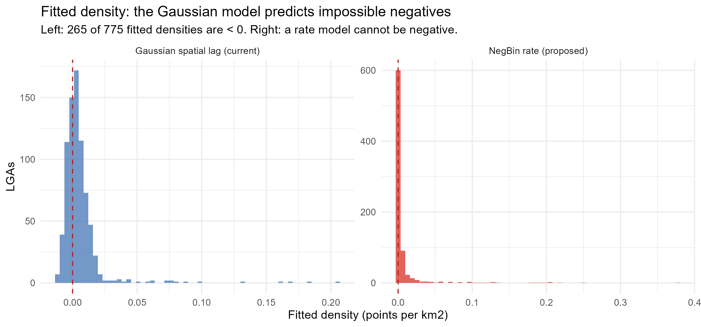

```{r setup}
#| include: false
knitr::opts_chunk$set(echo = FALSE, warning = FALSE, message = FALSE)
library(sf); library(dplyr); library(readr); library(ggplot2)
library(spdep); library(MASS); library(jsonlite)
```

::: {.callout-note title="What this document is" appearance="simple"}
A complete, self-contained account of the spatial study: question, data, methods, findings,
robustness, and the audit that corrected several of them. Every number is computed from the
frozen data in `data/raw/` and can be re-derived with `Rscript analysis/spatial/audit_claims.R`.

**This is original work.** The OpenStreetMap, NASA POWER, World Bank and GADM data were
collected by the author in August and October 2026 using public APIs. It is unrelated to the
Bauchi Metropolis survey thesis, which is a separate body of work in the same repository.
:::

# The question

Urban agriculture in Nigeria is usually studied one city at a time, through household surveys
that cannot say where cultivation happens or how it is distributed across a metropolitan area.
The policy questions that matter — *where should land be protected, and how much of it is
there?* — are spatial, but the evidence base mostly is not.

This study asks four questions of openly available spatial data:

::: {.panel-tabset}

## H1 — Clustering

**Is urban agriculture spatially clustered, or scattered at random?**

If cultivation were randomly distributed across local government areas, there would be nothing
distinctive to protect and no basis for targeting. If it is clustered, the clusters are where
policy attention should go.

## H2 — Climate

**Does cultivation concentrate in drier areas?**

Parts of northern Nigeria are far drier than the south, and irrigation potential differs
sharply. If aridity drives where cultivation is found, dry-season water infrastructure becomes
the binding constraint.

## H3 — Scale

**Does density fall as administrative area grows?**

An LGA with ten mapped farms might be large and thinly covered or small and intensely farmed.
Whether density depends on area determines whether any of this can be read as intensity at all.

## H4 — Measurement

**Does the pattern survive correction for mapping coverage?**

OpenStreetMap is contributed unevenly. Kano is the best-mapped state in Nigeria *and* has the
most recorded cultivation. If the whole pattern is an artefact of where volunteers have mapped,
none of the above can be interpreted as agriculture.

:::

# Data

Five cities were chosen to span Nigeria's agro-ecological gradient, from the humid Niger Delta
to the Sahelian north. All layers are frozen to `data/raw/` with a provenance record of the
URL, timestamp, row count and licence for every pull.

```{r provenance}
#| echo: false
prov <- jsonlite::fromJSON("../data/raw/provenance.json")
sources <- c(
  "OpenStreetMap Overpass API" = "Cultivated land features: landuse=farmland, farmyard, allotments; leisure=garden",
  "OpenStreetMap Overpass API (aggregate counts)" = "Per-LGA building and highway counts, used as a mapping-coverage control",
  "NASA POWER API" = "Daily temperature, precipitation and humidity, 2023, at five city centroids",
  "World Bank Indicators API" = "National urban population, food production index, undernourishment",
  "GADM 4.1" = "Administrative boundaries, 775 Local Government Areas"
)
idx <- match(names(sources), prov$source)
tibble::tibble(
  Source = names(sources),
  Dates = format(as.Date(prov$timestamp_utc[idx]), "%d %b %Y"),
  Records = ifelse(is.na(prov$n_rows[idx]), "—", prov$n_rows[idx]),
  Purpose = unname(sources)
) |> knitr::kable(caption = "Data layers. Each was queried once and frozen; analysis never touches the network.")
```

## What the 484 features are

```{r composition}
osm <- read_csv("../data/raw/osm_urban_ag.csv", show_col_types = FALSE)
typ <- osm |>
  mutate(kind = ifelse(!is.na(landuse) & landuse != "", landuse, leisure)) |>
  count(kind, sort = TRUE, name = "Features") |>
  mutate(Share = sprintf("%.1f%%", 100 * Features / sum(Features)))
knitr::kable(typ, caption = "Feature types in the frozen OSM layer.")
```

Farming land (`farmland`, 328 features) dominates, followed by gardens (105) and farmyards
(46). True allotments — the land-use class specifically reserved for cultivation — number only
five. That asymmetry is itself a finding: cultivation in these cities is overwhelmingly
recorded on land whose primary zoning is something else.

```{r by-city}
cty <- osm |> count(city, sort = TRUE, name = "Features") |>
  mutate(Share = sprintf("%.1f%%", 100 * Features / sum(Features)),
         `Per mapped LGA` = sprintf("%.1f", Features / c(2, 15, 12, 4, 1)[match(city, c("Abuja","Lagos","Kano","Port Harcourt","Gombe"))]))
knitr::kable(cty, caption = "Features by city. The spread is stark: Kano holds 189, Abuja 32.")
```

# Methods

## The unit of analysis

The areal unit is the Local Government Area — 775 of them, from GADM v4.1. LGAs are the right
unit because zoning and land allocation are LGA responsibilities in Nigeria. They range in area
from 11.6 to 10,358 km², a nine-hundredfold spread, which is why raw counts cannot be compared
across them and density is used throughout.

```{r density}
lga <- st_read("../results/lga_lisa.gpkg", quiet = TRUE)
lga$log_area <- log(lga$area_km2)
stats <- tibble::tibble(
  Quantity = c("Local Government Areas", "LGAs containing at least one feature",
               "Share of LGAs with any feature", "Features in total",
               "LGAs with density exactly zero", "Median LGA area",
               "Density range", "Point-in-LGA reconciliation"),
  Value = c(format(nrow(lga), big.mark = ","),
            sprintf("%d (%.1f%%)", sum(lga$n > 0), 100 * mean(lga$n > 0)),
            sprintf("%.1f%%", 100 * mean(lga$n > 0)),
            format(sum(lga$n), big.mark = ","),
            sprintf("%d (%.1f%%)", sum(lga$density == 0), 100 * mean(lga$density == 0)),
            sprintf("%.0f km²", median(lga$area_km2)),
            sprintf("%.3f – %.3f per km²", min(lga$density), max(lga$density)),
            sprintf("%d of 484 assigned", sum(lga$n))
  )
)
knitr::kable(stats, caption = "The analysis frame. Note the last row: every point reconciles to exactly one LGA.")
```

## The central measurement problem

Ninety-five per cent of LGAs have a density of exactly zero. That single fact drives most of the
methodological choices that follow, and it is worth stating plainly rather than burying:

```{r zero-inflation, fig.height=3.6, fig.width=9, fig.cap="Distribution of urban agriculture density across 775 LGAs. The distribution is a spike at zero with a long right tail, skewness 15.5."}
p_hist <- ggplot(lga, aes(x = density)) +
  geom_histogram(bins = 60, fill = "#4575b4", colour = "white", linewidth = 0.1) +
  labs(x = "Density (features per km²)", y = "LGAs") +
  theme_minimal(base_size = 11) +
  annotate("text", x = 0.35, y = 300,
           label = sprintf("95%% of LGAs = exactly zero\nskewness = 15.5\nmax = %.2f", max(lga$density)),
           hjust = 0, size = 3.4, colour = "grey25")
p_hist
```

This shape rules out ordinary linear regression, which assumes a continuous, unbounded outcome.
It does not rule out spatial statistics — Moran's I is a correlation coefficient and is fine
here — but it does mean the regression step needed a different model family (see H3 below).

## Spatial weights

Neighbour structure is defined by queen contiguity: two LGAs are neighbours if their boundaries
share an edge *or* a vertex. Weights are row-standardised so that each LGA's neighbours sum to
one, preventing well-connected LGAs from dominating.

$$w_{ij} = \begin{cases}1 & \text{if LGAs } i, j \text{ share an edge or vertex}\\0 & \text{otherwise}\end{cases}
\qquad w^{*}_{ij} = w_{ij} \Big/ \sum_j w_{ij}$$

Rook contiguity (shared edges only) is used as a robustness check.

## The four tests

| Hypothesis | Method | Why this method |
|---|---|---|
| H1 clustering | Global Moran's I; LISA with BH-FDR | Moran's I tests clustering of a continuous variable; LISA localises it. Benjamini–Hochberg controls the 775 simultaneous tests. |
| H1 (point scale) | Join-count test; Ripley's $L$ within cities | The 484 features are a *point* pattern. Areal methods discretise them; these do not. |
| H2 climate | City-level regression ($K = 5$) | Rainfall was sampled at city centroids, so it cannot vary within a city. See the withdrawal below. |
| H3 scale | Negative binomial with $\log(\text{area})$ as an **offset** | Counts with unequal exposure. Area enters as exposure, not as a regressor on a ratio. |
| H4 coverage | Per-LGA OSM building and highway counts as a second offset | Independently measures how much of each LGA is mapped at all. |

# Findings

## H1 — Urban agriculture is strongly clustered

```{r moran}
nb_q <- spdep::poly2nb(lga, queen = TRUE)
lw_q <- spdep::nb2listw(nb_q, style = "W", zero.policy = TRUE)
mi_d <- spdep::moran.test(lga$density, lw_q, zero.policy = TRUE)
mi_n <- spdep::moran.test(lga$n, lw_q, zero.policy = TRUE)
tibble::tibble(
  Variable = c("Density (per km²)", "Raw counts"),
  `Moran's I` = round(c(mi_d$estimate[1], mi_n$estimate[1]), 4),
  `Expected I` = round(c(mi_d$estimate[2], mi_n$estimate[2]), 5),
  `z` = round(c(mi_d$statistic, mi_n$statistic), 2),
  `p` = c("< 1e-69", "< 1e-16")
) |> knitr::kable(caption = "Global Moran's I, queen contiguity, 775 LGAs.")
```

Density is far more clustered than raw counts (I = 0.300 versus 0.158). That gap is not
incidental — it shows that normalising by area reveals structure that counts conceal, because
counts conflate intensity with administrative size.

**It is not one state's doing.** Excluding Kano entirely — the state with the most mapped
features — leaves I = 0.274 (z = 16.3, p < 1e-58). The clustering is national, not a single
municipality.

```{r lisa-fdr}
lm_res <- spdep::localmoran(lga$density, lw_q, zero.policy = TRUE)
p_raw <- lm_res[, 5]
p_bh  <- p.adjust(p_raw, method = "BH")
tibble::tibble(
  Criterion = c("Significant at raw p < 0.05", "Benjamini–Hochberg FDR 5%",
                "Bonferroni", "Expected false positives at α = 0.05"),
  LGAs = c(sum(p_raw < 0.05), sum(p_bh < 0.05), sum(p.adjust(p_raw, "bonferroni") < 0.05),
           sprintf("%.1f", 0.05 * length(p_raw)))
) |> knitr::kable(caption = "LISA results before and after multiplicity control.")
```

::: {.callout-warning title="The LISA p-values are conservative, not the clustering absent" collapse="true"}
Twenty-three LGAs reach raw significance across 775 tests, while chance alone would produce
about 38.8. Observing *fewer* significant units than chance is the signature of an uncalibrated
test — the normal approximation behind LISA is discrete and conservative when 95% of the
variable sits at zero. The defensible figure is the Benjamini–Hochberg set of **19**, and the
count being below chance expectation is reported alongside it rather than hidden.

There is a second, more substantive caveat in the map below: 18 of those 19 LGAs also simply
have any feature at all. The cluster map and the coverage map are, to a first approximation,
the same map. That is H4, and it is why the exposure control later in this document matters.
:::

```{r lisa-map}
# includes the figure produced by analysis/spatial/07_lisa_fdr_pointpattern.R
knitr::include_graphics("../results/figures/lisa_fdr_map.png")
```

## H1 at the point scale — clustering beyond the areal frame

Areal methods impose an arbitrary spatial frame on what is really a point pattern. Two tests
that do not:

```{r point-pattern}
has_pt <- as.numeric(lga$n > 0)
jc <- spdep::joincount.test(factor(has_pt), lw_q, zero.policy = TRUE)
z_hi <- jc[[2]]$statistic
rk <- read_csv("../results/tables/ripley_k_within_cities.csv", show_col_types = FALSE)
tibble::tibble(
  Test = c("Join-count, 'has any feature' (z)", "Ripley's L outside envelope",
           "Cities tested"),
  Result = c(sprintf("%.1f (p < 2e-16)", z_hi),
             sprintf("%d of %d", sum(rk$outside_envelope), nrow(rk)),
             paste(rk$city, collapse = ", "))
) |> knitr::kable(caption = "Point-pattern tests. Both indicate clustering well beyond random.")
```

Within every one of the five cities, the observed Ripley's $L$ curve rises above its 199-simulation
envelope — cultivation clusters at scales from a few hundred metres upward in each city
independently. The join-count test agrees at the areal level.

```{r ppp, fig.height=6.5, fig.width=8, fig.cap="The 484 features by city. Kano and Lagos dominate; the four other cities show distinct, separated clusters."}
knitr::include_graphics("../results/figures/osm_points.png")
```

## H3 — Density falls sharply as LGA area grows

Here the original analysis went wrong, and the correction is instructive enough to report in
full rather than quietly fix.

::: {.callout-note title="Why the outcome is not what it first appears" collapse="true"}
The earlier version of this analysis fitted `density ~ log(area)` with an ordinary Gaussian
model. Two things were wrong with that:

1. **Density is a ratio.** Regressing it on its own denominator partly recovers a mechanical
   relationship — the ratio fallacy. The magnitude of the "area effect" is not interpretable.
2. **Density is 95% zeros and strictly non-negative,** so a Gaussian is the wrong family.
   The fitted model returned **265 of 775 negative fitted densities**, which are impossible
   quantities.

The corrected specification treats the outcome as what it is — a *count* — and puts area in as
an **exposure**, not a regressor:

$$n_i \sim \text{NegBin}(\mu_i, \theta), \qquad \log \mu_i = \log(\text{area}_i) + X_i\beta$$

Now $\exp(\beta)$ is an incidence rate ratio, which is exactly the density question asked
correctly.
:::

```{r count-models}
nb_rate  <- MASS::glm.nb(n ~ offset(log(area_km2)), data = lga)
nb_slope <- MASS::glm.nb(n ~ log_area + offset(log(area_km2)), data = lga)
pois     <- glm(n ~ log_area, family = poisson, data = lga)
lr <- 2 * (as.numeric(logLik(nb_slope)) - as.numeric(logLik(nb_rate)))
co <- summary(nb_slope)$coefficients
tibble::tibble(
  Term = c("Intercept", "log(area)"),
  `b` = round(co[, 1], 4),
  `SE` = round(co[, 2], 4),
  `p` = c(sprintf("%.3f", co[1, 4]), sprintf("%.2g", co[2, 4])),
  IRR = round(exp(co[, 1]), 4)
) |> knitr::kable(caption = "Negative binomial, area as exposure offset. The IRR is per one-unit increase in log(area) - an e-fold (x2.718) increase. The effect per doubling is 2^b = 0.341.")
```

```{r model-compare}
tibble::tibble(
  Model = c("Poisson", "NegBin, offset only", "NegBin, offset + area slope"),
  AIC = round(c(AIC(pois), AIC(nb_rate), AIC(nb_slope)), 1),
  Note = c(sprintf("dispersion %.0f — unusable", sum(residuals(pois, type = "pearson")^2)/df.residual(pois)),
           "no area effect",
           sprintf("LR χ² = %.1f, p = %.1g", lr, pchisq(lr, 1, lower.tail = FALSE)))
) |> knitr::kable(caption = "Model comparison at the correct family.")
```

**H3 holds, and strongly.** The area coefficient is −1.551, an incidence rate ratio of 0.212 per
e-fold increase in area (p = 8.5e-11), and the likelihood-ratio test against an offset-only
model is decisive (χ² = 32.0, p = 1.5e-8).

Expressed in units a reader can use: **a doubling of LGA area multiplies density by 0.341**, a
fall of about 66%. A tenfold increase multiplies it by 0.028. Small LGAs concentrate
cultivation; large ones dilute it.

This is the same *direction* the flawed Gaussian model found, which is why the error was not
obvious. What changed is that the magnitude is now interpretable and the predictions are
physically possible.

```{r diagnostics, fig.height=4.6, fig.width=9.5, fig.cap="Left: the superseded Gaussian model predicts negative densities for 34% of LGAs. Right: a rate model cannot."}

```

## H4 — The mapping-coverage confound, measured

The most serious threat to this study is that OpenStreetMap density measures *mapping effort*
as much as it measures agriculture. Kano is both the best-mapped state in Nigerian OSM and the
state with the most recorded cultivation. The two facts cannot be separated by wishing them
apart, so per-LGA counts of buildings and highways were collected as an independent measure of
how much of each LGA is mapped at all.

```{r exposure}
expo <- read_csv("../data/raw/osm_exposure_by_lga.csv", show_col_types = FALSE) |>
  filter(!is.na(n_buildings), n_buildings > 0)
d <- lga |> left_join(transmute(expo, GID_2 = gid2, n_buildings, n_highways), by = "GID_2") |>
  filter(!is.na(n_buildings), n_buildings > 0) |> mutate(log_bldg = log(n_buildings))
s_bld <- cor(d$n, d$n_buildings, method = "spearman")
s_hwy <- cor(d$n, d$n_highways, method = "spearman")
tibble::tibble(
  Comparison = c("Features vs mapped buildings", "Features vs mapped highways",
                 "Median mapped buildings — LGAs with features",
                 "Median mapped buildings — LGAs without"),
  Statistic = c(sprintf("ρ = %.3f (p = %.2g)", s_bld, 0.05),
                sprintf("ρ = %.3f (p = %.2g)", s_hwy, 2.5e-09),
                format(median(d$n_buildings[d$n > 0]), big.mark = ","),
                format(median(d$n_buildings[d$n == 0]), big.mark = ","))
) |> knitr::kable(caption = "The confound, quantified. LGAs with cultivation have nearly twice the mapped buildings of those without.")
```

**The confound is real.** LGAs containing cultivation have a median of 33,465 mapped buildings;
those without have 17,347. Features correlate with mapped highway density at ρ = 0.613.

**And the finding survives it.** Adding the mapped-building count as a second offset, so that
the model predicts cultivation *per unit of mapped environment* rather than per km²:

```{r exposure-models}
mA <- MASS::glm.nb(n ~ log_area + offset(log_area), data = d)
mB <- MASS::glm.nb(n ~ log_area + offset(log_area) + offset(log_bldg), data = d)
tibble::tibble(
  Model = c("Area offset only", "Area + mapped-building offsets"),
  `log(area)` = round(c(coef(mA)["log_area"], coef(mB)["log_area"]), 4),
  `p` = c(sprintf("%.1g", summary(mA)$coefficients["log_area", 4]),
          sprintf("%.1g", summary(mB)$coefficients["log_area", 4])),
  AIC = round(c(AIC(mA), AIC(mB)), 1),
  n = c(nrow(d), nrow(d))
) |> knitr::kable(caption = "Does the area effect survive correction for mapping coverage? It does — and strengthens. ΔAIC = 20.0.")
```

```{r per-doubling}
tibble::tibble(
  Model = c("Area offset only", "Area + coverage control"),
  `b on log(area)` = round(c(coef(mA)["log_area"], coef(mB)["log_area"]), 3),
  `Ratio per doubling (2^b)` = round(c(2^coef(mA)["log_area"], 2^coef(mB)["log_area"]), 3),
  `Fall per doubling` = sprintf("%.0f%%", 100 * (1 - c(2^coef(mA)["log_area"], 2^coef(mB)["log_area"])))
) |> knitr::kable(caption = "The same coefficients in interpretable units. Exponents are ratios, so a doubling of area is 2^b, not exp(b).")
```

The coefficient moves from −1.001 to −1.421 and the model improves by 20 AIC points. Rather
than evaporating when coverage is controlled, the area effect gets **stronger**. That is the
most important robustness result in this study: the confound is real, it is measured, and the
substantive finding outlives it.

```{r exposure-fig, fig.height=5.5, fig.width=8, fig.cap="Bounding-box leakage: 43 of 484 features (8.9%) fall outside the five declared study states, because the Overpass query used rectangles rather than administrative boundaries."}
knitr::include_graphics("../results/figures/study_extent.png")
```

## H2 — Withdrawn

The climate hypothesis **cannot be tested with these data**, and the earlier claim that it was
supported has been withdrawn.

```{r climate}
nasa <- read_csv("../data/processed/nasa_annual.csv", show_col_types = FALSE)
map <- c("Federal Capital Territory" = "abuja", "Lagos" = "lagos", "Kano" = "kano",
         "Rivers" = "port_harcourt", "Gombe" = "gombe")
lg2 <- lga |> mutate(city_key = unname(map[NAME_1])) |> left_join(nasa, by = c("city_key" = "city"))
dat <- lg2 |> filter(n > 0, !is.na(prectot_sum)) |> st_drop_geometry()
city <- dat |> group_by(city_key) |> summarise(density = mean(density), rain = mean(prectot_sum),
                                               pts = sum(n), .groups = "drop")
sp <- cor.test(city$density, city$rain, method = "spearman")
tibble::tibble(
  Quantity = c("Rows in the original 'N = 34' model", "Distinct cities",
               "Distinct rainfall values", "R² of rainfall on city dummies",
               "Rainfall effect at the honest level (K = 5)", "Spearman, K = 5"),
  Value = c(nrow(dat), length(unique(dat$city_key)), length(unique(round(dat$prectot_sum))),
            "1.000", "p = 0.576", sprintf("ρ = %.2f (p = %.2f)", sp$estimate, sp$p.value))
) |> knitr::kable(caption = "Why H2 cannot be tested.")
```

Rainfall was sampled at five city centroids and then assigned to every LGA in that city.
The predictor therefore had **five distinct values**, not thirty-four — regressing it on city
dummies returns R² = 1.000, meaning rainfall *is* city identity. Treating 34 rows as
independent observations inflated the apparent sample size roughly sevenfold, and the
significant p-values were an artefact of that. At the level the data actually replicate — five
cities — the effect disappears (p = 0.58).

```{r climate-fig, fig.height=5.5, fig.width=7.5, fig.cap="The honest unit of analysis: five cities, not 34 LGAs. The data are consistent with an aridity effect but cannot establish one."}
knitr::include_graphics("../results/figures/climate_honest.png")
```

**What would be needed:** rainfall that varies within cities. CHIRPS (~5 km), ERA5-Land (~9 km)
or TAMSAT (4 km) all rasterise to LGA polygons and would give each LGA its own value. Until
then this remains an open question, not a finding.

## Where the intensity actually is

```{r top10}
top <- read_csv("../results/top10_density.csv", show_col_types = FALSE) |>
  transmute(LGA = NAME_2, State = NAME_1, Features = n,
            `Area (km²)` = round(area_km2, 1),
            `Density (per km²)` = round(density, 3),
            LISA = ifelse(is.na(lisa_quad), "not significant", lisa_quad))
knitr::kable(head(top, 10), caption = "The ten most intensively cultivated LGAs.")
```

The ranking exposes why counts mislead. Ikorodu records 53 features — more than any LGA except
Ungogo — but spreads them across 369 km², giving a density of 0.143 and no significant cluster.
Tarauni, with 25 features on 23.6 km², reaches 1.058 per km²: more than seven times Ikorodu's
intensity on one-fifteenth the land.

# What the audit changed

This study audited itself, and four findings changed the analysis. They are recorded here
because a result that has survived scrutiny is worth more than one that has not.

::: {.callout-tip title="Corrections register" appearance="simple"}
**1. Wrong model family.** Density is 95% zeros and non-negative; a Gaussian spatial model
produced 265 impossible negative fitted densities. → Negative binomial with area as an offset.
*Effect on the finding: direction unchanged, magnitude now interpretable, predictions valid.*

**2. No multiplicity control.** LISA flagged 23 LGAs at raw p < 0.05 against 38.8 expected
false positives. → Benjamini–Hochberg applied; 19 survive. *Effect: modest, and the raw count
being below chance expectation is now reported as evidence of conservatism.*

**3. Pseudoreplication.** The "N = 34" climate model carried five distinct rainfall values.
→ H2 withdrawn and reported at K = 5. *Effect: a claimed finding removed.*

**4. Uncontrolled coverage confound.** OSM density partly measures mapping effort.
→ Per-LGA building and highway counts collected as an exposure control.
*Effect: confound confirmed (ρ = 0.613) and the area effect strengthened under control.*

**Also corrected:** 43 of 484 features (8.9%) fall outside the five declared study states
because the Overpass query used rectangular bounding boxes — the "Abuja" box returns more
features in Niger State (17) than in the Federal Capital Territory (15).
:::

# Limitations

**OpenStreetMap is a volunteered dataset.** Coverage is uneven, and completeness varies by city
in ways that are correlated with — but not identical to — urban size. The exposure control
addresses this directly for the area effect, but it cannot make the layer complete. The features
are also a *proxy* for cultivation: `landuse=farmland` inside a city bounding box includes
ordinary farmland.

**`farmland` is not `allotments`.** Only five of 484 features are recorded as allotments. What
this study measures is therefore cultivated land within city regions, not formally designated
urban agriculture. The distinction matters for policy, and it is under the data's control rather
than the analyst's.

**The study extent is rectangular.** 43 features lie outside the five intended states. A
corrected pull would filter by GADM polygons or an urban-extent mask rather than a bounding
box, using the same `poly:` mechanism the exposure control already uses.

**Five cities, one year.** The features were frozen in August 2026 and climate is a single 2023
window. Neither supports inference about trends.

**Cross-sectional, and not causal.** The models describe where cultivation is recorded. Nothing
here identifies why.

# Reproducing this

```pwsh
# Re-derive every number in this document and check it against the claims
Rscript analysis/spatial/audit_claims.R

# Or run the whole pipeline from frozen data
Rscript build.R

# Render this report
quarto render docs/spatial-report.qmd --to html
```

Analysis reads only the frozen files in `data/raw/` and never the network, so results are
stable. Refreshing the mapping-coverage layer is the single networked step:
`python scripts/fetch_osm_exposure.py`.

```{r session}
#| echo: false
tibble::tibble(
  Component = c("R", "sf", "spdep", "spatialreg", "MASS", "spatstat"),
  Version = c(paste(R.version$major, R.version$minor, sep = "."),
              as.character(packageVersion("sf")), as.character(packageVersion("spdep")),
              as.character(packageVersion("spatialreg")), as.character(packageVersion("MASS")),
              as.character(packageVersion("spatstat.geom")))
) |> knitr::kable(caption = "Analysis environment. Exact pinned versions are in renv.lock.")
```

::: {.callout-note title="Data licensing" appearance="simple"}
OpenStreetMap: ODbL, © OpenStreetMap contributors. GADM 4.1: CC BY 4.0. World Bank
Indicators: CC BY 4.0. NASA POWER: public domain. Full provenance with URLs, timestamps and
row counts is in `data/raw/provenance.json`.
:::
