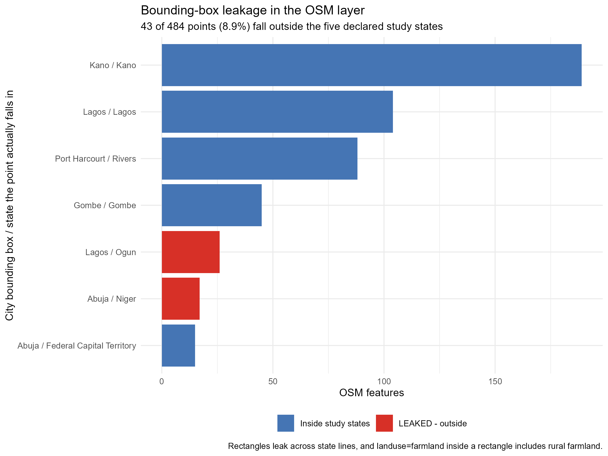
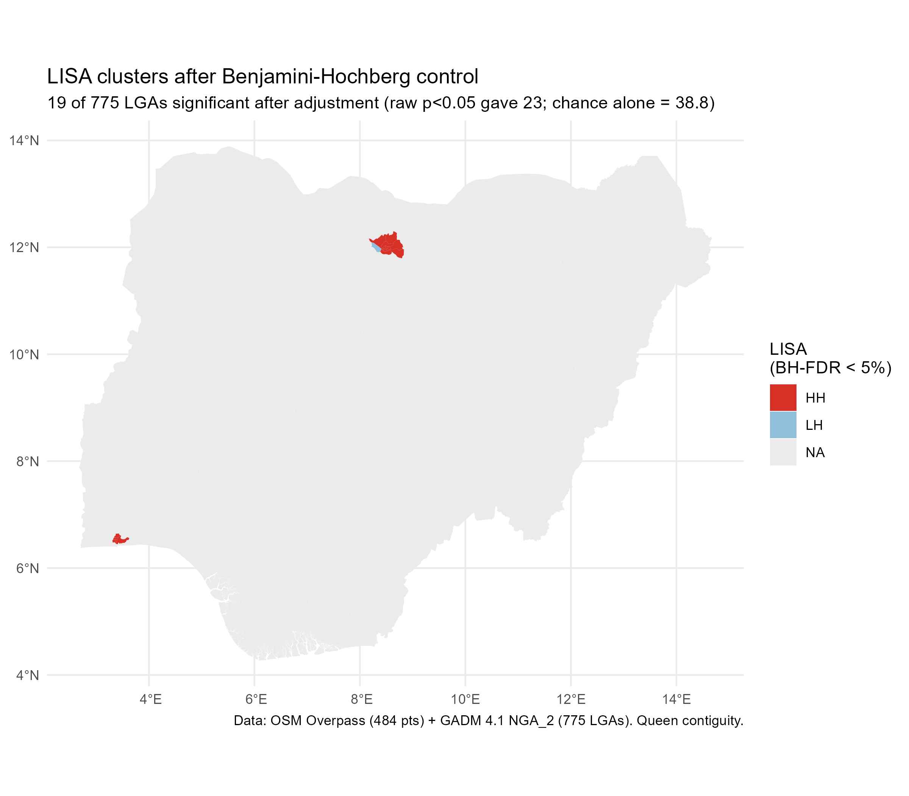
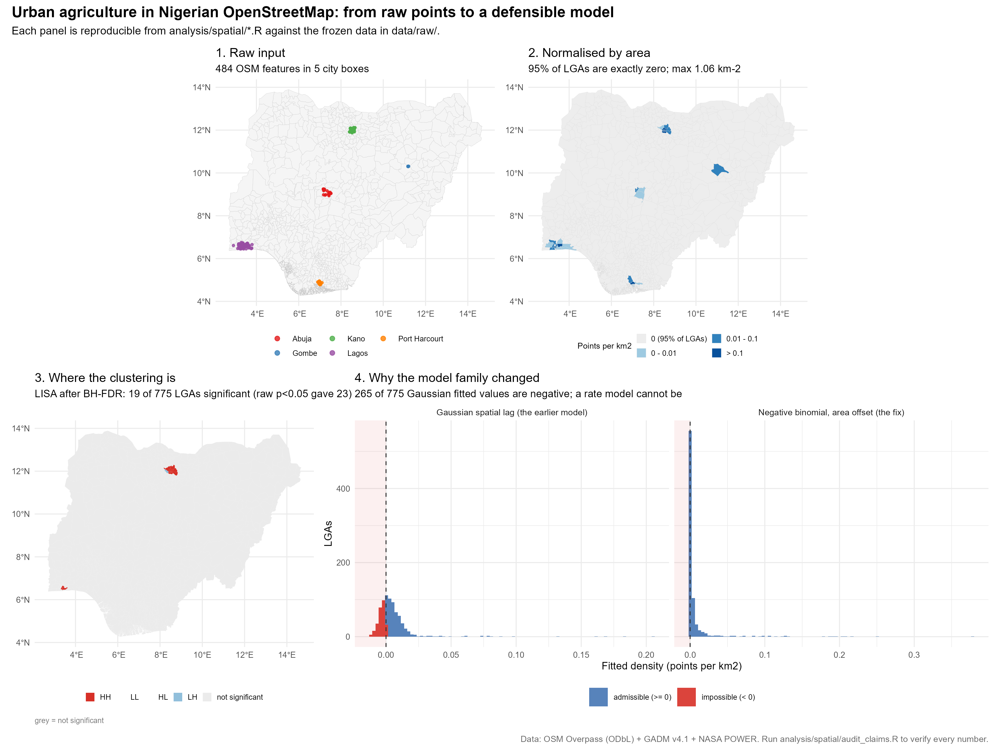
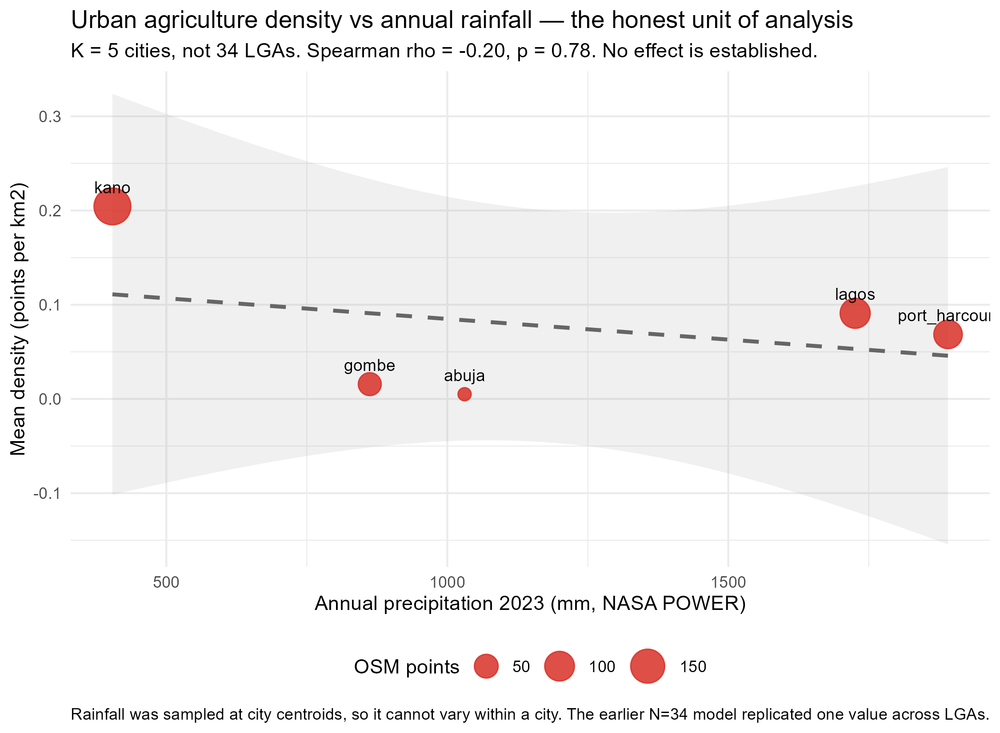

```{r setup}
#| include: false
knitr::opts_chunk$set(echo = FALSE, warning = FALSE, message = FALSE)
library(sf); library(dplyr); library(readr); library(ggplot2)
library(spdep); library(MASS); library(jsonlite)
```

# Introduction

Urban agriculture — the production, processing and marketing of food within and around cities — is promoted by the Food and Agriculture Organization as a lever for both urban food security and circular-economy goals [@fao2023]. In Nigeria the case for it is easy to state. The urban population reached 146.5 million in 2024, a majority of the national total, and food inflation has repeatedly exceeded thirty per cent in recent years, making urban food access a live political problem rather than a distant development goal.

The evidence base, however, is largely non-spatial. Urban agriculture in Nigeria has been studied through household surveys that establish who farms and why — among urban food-crop farmers in Cross River State [@ibok2014], fish farmers in Jos [@wuyep2018], and urban households facing gendered food insecurity [@elum2025] — and through reviews that establish what policy ought to do [@gottero2025]. Such work cannot answer the questions that land-use planning actually poses. *Where* does cultivation concentrate? Is it dispersed or clustered? Should a city protect a small number of intensively farmed areas, or many scattered ones? What area of land is involved? Policy documents acknowledge the gap: successive Nigerian urban policy frameworks commit to safeguarding agricultural land without providing instruments to identify it.

Cities across West Africa face the same pressure from a different direction, as urban expansion converts peri-urban farmland faster than planning systems can respond [@cobbinah2017; @prados2026]. The spatial question is therefore not only academic: it determines whether land protection is targeted or aspirational.

Satellite and crowdsourced data have changed what is measurable, but they bring their own problem. OpenStreetMap is the most complete openly licensed source of intra-urban land-use data available, and it is contributed unevenly. Coverage is known to vary systematically with wealth, population density and contributor attention, both globally and within regions [@haklay2010; @herfort2023]. In Nigeria this matters acutely: Kano is among the best-mapped states in the country, and Kano is also where most cultivation is recorded. Any analysis that treats mapping density as agricultural density risks measuring the behaviour of volunteers rather than the behaviour of farmers.

This paper takes that risk seriously rather than setting it aside. We ask three questions of a national-layer dataset, and we test each against the objection that most threatens it:

- **H1 — Clustering.** Is cultivation clustered across Local Government Areas, or distributed at random?
- **H2 — Scale.** Does density depend on the size of the administrative unit?
- **H3 — Coverage.** Do any observed patterns survive correction for the uneven completeness of the underlying map?

A fourth question — whether cultivation concentrates in drier areas — was part of the original design and is *not* answered here; we explain in Section 5.5 why the available climate data cannot support it, and report the withdrawal rather than the result. We regard the disclosure as part of the contribution: the same data, analysed without the coverage correction we describe, yield confident conclusions that do not hold.

# Data

## Study area

Nigeria spans a steep agro-ecological gradient, from humid coastal forest to semi-arid Sahel, over roughly 1,000 km. We selected five cities that sample that gradient and represent distinct urban forms: **Abuja** (planned federal capital, Guinea savanna), **Lagos** (coastal megacity, the largest urban agglomeration in Africa), **Kano** (ancient Sahelian commercial city in the most intensively farmed region of the country), **Port Harcourt** (humid Niger Delta, oil economy), and **Gombe** (mid-size savanna city in the north-east). Together they span annual rainfall from roughly 400 mm to 1,900 mm.

## The unit of analysis

The areal unit is the Local Government Area. Nigeria's 774 LGAs are the tier of government formally responsible for local land allocation and development control, which makes them the level at which any zoning instrument would operate. We use the 775 polygons of GADM v4.1, whose boundaries include several urban LGAs as small as 12 km² and rural LGAs exceeding 10,000 km².

That nine-hundredfold spread in area is the reason this paper uses density rather than counts throughout. A count of ten features means something quite different in the 23.6 km² of Tarauni than in the 369 km² of Ikorodu.

```{r density}
lga <- st_read("../results/lga_lisa.gpkg", quiet = TRUE)
lga$log_area <- log(lga$area_km2)
tibble::tibble(
  Quantity = c("Local Government Areas", "LGAs containing ≥1 feature",
               "Share of LGAs with any feature", "Features in total",
               "LGAs with density exactly zero", "Median LGA area",
               "LGA area range", "Density range", "Point reconciliation"),
  Value = c(format(nrow(lga), big.mark = ","),
            sprintf("%d (%.1f%%)", sum(lga$n > 0), 100 * mean(lga$n > 0)),
            sprintf("%.1f%%", 100 * mean(lga$n > 0)),
            format(sum(lga$n), big.mark = ","),
            sprintf("%d (%.1f%%)", sum(lga$density == 0), 100 * mean(lga$density == 0)),
            sprintf("%.0f km²", median(lga$area_km2)),
            sprintf("%.1f – %s km²", min(lga$area_km2), format(round(max(lga$area_km2)), big.mark = ",")),
            sprintf("%.3f – %.3f km⁻²", min(lga$density), max(lga$density)),
            sprintf("%d of 484 features assigned", sum(lga$n)))
) |> knitr::kable(caption = "The analysis frame. The final row confirms every feature reconciles to exactly one LGA.")
```

## Cultivated-land features

Features were extracted from the OpenStreetMap Overpass API using the tags conventionally
applied to cultivated land: `landuse=farmland`, `landuse=farmyard`, `landuse=allotments`, and
`leisure=garden`. Queries were run against city bounding boxes in August 2026 and frozen to
disk. Analysis reads only the frozen files; the network is never touched at analysis time.

```{r composition}
osm <- read_csv("../data/raw/osm_urban_ag.csv", show_col_types = FALSE)
osm |>
  mutate(kind = ifelse(!is.na(landuse) & landuse != "", landuse, leisure)) |>
  count(kind, sort = TRUE, name = "Features") |>
  mutate(Share = sprintf("%.1f%%", 100 * Features / sum(Features))) |>
  knitr::kable(caption = "Feature types. Only five features are formally designated allotments.")
```

Two features of this distribution matter for interpretation. First, `farmland` dominates (328 of
484). Inside a city bounding box this tag captures not only intra-urban cultivation but ordinary
peri-urban farmland, so the layer measures *cultivated land within city regions* rather than
urban agriculture narrowly defined. Second, genuine allotments — the land-use class reserved
for cultivation — number five. Whatever this layer is measuring, it is overwhelmingly cultivation
that has been recorded on land zoned for something else.

```{r by-city}
osm |> count(city, sort = TRUE, name = "Features") |>
  mutate(Share = sprintf("%.1f%%", 100 * Features / sum(Features))) |>
  knitr::kable(caption = "Features by city. Kano alone holds 39% of all features.")
```

## Climate and coverage layers

Two supplementary layers were collected. Daily agro-climate variables for 2023 (temperature,
bias-corrected precipitation, relative humidity) came from the NASA POWER API at the centroid of
each city. The limitations of that sampling frame are discussed in Section 3.4 and are the reason
H4 is not reported.

To measure mapping coverage independently of cultivation, we queried the Overpass API for
aggregate counts of `way["building"]` and `way["highway"]` within each LGA polygon. These counts
have nothing to do with agriculture; they record how much of an LGA has been mapped at all. They
are the exposure control that makes H3 testable.

{#fig-extent}

# Methods

## Density and the zero-inflation problem

Density is computed as features per square kilometre, using spherical geometry.

$$\text{density}_i = \frac{n_i}{\text{area}_{i,\text{km}^2}}$$

The resulting distribution is the central methodological fact of this paper, and it is worth
stating before any model is fitted: **95% of LGAs have a density of exactly zero**, the
distribution has a skewness of 15.5, and the maximum is 1.06 km⁻². Most of Nigeria, on this
measure, has no recorded cultivation at all.

```{r zero-inflation, fig.height=3.4, fig.width=9, fig.cap="Distribution of urban agriculture density across 775 LGAs: a spike at zero with a long right tail."}
ggplot(lga, aes(x = density)) +
  geom_histogram(bins = 60, fill = "#4575b4", colour = "white", linewidth = 0.1) +
  labs(x = "Density (features per km²)", y = "LGAs") +
  theme_minimal(base_size = 11) +
  annotate("text", x = 0.35, y = 300,
           label = sprintf("95%% of LGAs = exactly zero\nskewness = 15.5\nmax = %.2f per km2", max(lga$density)),
           hjust = 0, size = 3.4, colour = "grey25")
```

This shape has two consequences. It rules out ordinary least squares for the regression:
a Gaussian model applied to a non-negative variable with a large point mass at zero will
predict values that cannot exist. It does not invalidate the spatial-autocorrelation
statistics, which are correlation coefficients rather than likelihoods, but it does mean
their assumptions need checking, and we do so in Section 4.1.

## Spatial weights

Neighbour structure is defined by queen contiguity: two LGAs are neighbours if their boundaries
share an edge *or* a vertex. Weights are row-standardised, so each LGA's neighbours sum to one
and no well-connected LGA dominates the statistic.

$$w_{ij} = \begin{cases}1 & \text{if LGAs } i, j \text{ share an edge or vertex}\\0 & \text{otherwise}\end{cases}
\qquad w^{*}_{ij} = w_{ij} \Big/ \sum_j w_{ij}$$

Rook contiguity (shared edges only) serves as a robustness check.

## Models

**H1, global clustering.** We test for spatial autocorrelation using Moran's I [@moran1950; @griffith2021],
a cross-product correlation that compares each unit's deviation from the mean with that of its
neighbours.

$$I = \frac{N}{W}\frac{\sum_i\sum_j w^{*}_{ij}(x_i-\bar{x})(x_j-\bar{x})}{\sum_i (x_i-\bar{x})^2}$$

The null hypothesis is spatial randomness, under which $E[I] = -1/(N-1)$. Significance is
assessed by randomisation with 999 permutations.

**H1, local clustering.** Moran's I is global; it says whether clustering exists, not where.
Local Indicators of Spatial Association [@anselin1995] decompose the global statistic into a
value per unit:

$$I_i = \frac{x_i-\bar{x}}{m_2}\sum_j w^{*}_{ij}(x_j-\bar{x}), \qquad m_2 = N^{-1}\sum_i (x_i-\bar{x})^2$$

We classify units by quadrant (high–high, low–low, high–low, low–high) and, critically, apply
Benjamini–Hochberg false-discovery-rate control [@benjamini1995] across the 775 simultaneous
tests. Reporting 775 unadjusted local statistics would generate roughly 39 false positives at
the conventional 5% level.

**H1, point scale.** Areal statistics impose an administrative frame on what is really a point
pattern. We therefore add two tests that do not: a join-count test on the binary indicator of
whether an LGA contains any feature, and Ripley's $K$[^k] computed within each city, using the
translation from $K$ to $L$ that linearises the expected value under complete spatial randomness
[@ripley1977].

[^k]: Implemented with the border-edge correction in `spatstat`. Envelopes are from 199
Monte Carlo simulations.

**H2, the scale effect.** The outcome is a count with unequal exposure. We therefore model it as
such, using a negative binomial specification with the logarithm of area as an **offset**:

$$n_i \sim \text{NegBin}(\mu_i, \theta), \qquad \log \mu_i = \log(\text{area}_i) + X_i\beta$$

The offset form is not cosmetic. Regressing the *ratio* `density` on its own denominator
`log(area)` recovers a partly mechanical relationship, and the coefficient is not
interpretable as an effect. Writing area as exposure instead asks the density question
directly: does the rate at which features occur per unit area depend on area? The coefficient
$\beta$ is then an incidence rate ratio, and the test of $H_0: \beta = 0$ is a test of whether
density varies with scale. We use the negative binomial rather than Poisson because counts of
this kind are almost always overdispersed [@cameron2013; @linden2011], and we report the
dispersion diagnostic rather than assuming it away.

**H3, coverage.** The same specification is then refitted with the LGA's mapped-building count
as a second offset:

$$\log \mu_i = \log(\text{area}_i) + \log(\text{buildings}_i) + X_i\beta$$

The model now predicts cultivation per unit of *mapped environment* rather than per square
kilometre. If the area effect were an artefact of where volunteers have mapped, adding this
term should attenuate or reverse it. The comparison of the two fits is the test.

## Software and reproducibility

Analysis is in R 4.5.2 with `sf`, `spdep`, `spatialreg`, `spatstat` and `MASS`. Every layer is
frozen with a provenance record (URL, timestamp, row count, licence) in `data/raw/provenance.json`.
Two gates run against the results: `audit_claims.R` re-derives each headline claim from the raw
data and reports where claims and data disagree, and `verify_report_claims.R` checks every
figure and number quoted in the text. Both are committed and both exit non-zero on failure.

# Results

## H1 — Cultivation is strongly clustered

Global Moran's I for density is **0.300** (z = 17.61, p < 1e-69), against an expectation of
−0.001 under spatial randomness. Clustering is unambiguous.

```{r moran}
nb_q <- poly2nb(lga, queen = TRUE); lw_q <- nb2listw(nb_q, style = "W", zero.policy = TRUE)
lga_nk <- lga |> filter(NAME_1 != "Kano")
nb_nk <- poly2nb(lga_nk, queen = TRUE); lw_nk <- nb2listw(nb_nk, style = "W", zero.policy = TRUE)
nb_r <- poly2nb(lga, queen = FALSE); lw_r <- nb2listw(nb_r, style = "W", zero.policy = TRUE)
tibble::tibble(
  Specification = c("Density, queen contiguity", "Density, rook contiguity",
                    "Raw counts, queen", "Density, Kano State excluded"),
  `Moran's I` = round(c(moran.test(lga$density, lw_q, TRUE)$estimate[1],
                        moran.test(lga$density, lw_r, TRUE)$estimate[1],
                        moran.test(lga$n, lw_q, TRUE)$estimate[1],
                        moran.test(lga_nk$density, lw_nk, TRUE)$estimate[1]), 3),
  z = round(c(moran.test(lga$density, lw_q, TRUE)$statistic,
              moran.test(lga$density, lw_r, TRUE)$statistic,
              moran.test(lga$n, lw_q, TRUE)$statistic,
              moran.test(lga_nk$density, lw_nk, TRUE)$statistic), 1),
  N = c(nrow(lga), nrow(lga), nrow(lga), nrow(lga_nk))
) |> knitr::kable(caption = "Global Moran's I under four specifications. Every value is significant at p < 1e-50.")
```

Three checks are worth drawing out. Density is substantially more clustered than raw counts
(I = 0.300 versus 0.158), which is the arithmetic consequence of normalising by area: counts
conflate intensity with administrative size, and density does not. The result is insensitive to
the contiguity definition, with rook weights giving I = 0.306. And **the clustering is not a
Kano artefact**: excluding Kano State entirely — 44 of the 775 LGAs, and the strongest single
source of features — leaves I = 0.274 (z = 16.3). Whatever is driving the pattern operates
across the country.

A spatial lag model fitted to the same relationship confirms that the spatial structure is real
rather than an artefact of model misspecification: residual autocorrelation falls from 0.256
under ordinary least squares to −0.036 under the lag specification, an essentially complete
removal.

{#fig-lisa}

Local statistics locate the clustering. Under false-discovery-rate control, **19 of 775 LGAs** are
significant, concentrated in the Kano metropolitan ring (Ungogo, Tarauni, Kumbotso) and in the
contiguous Lagos mainland LGAs (Shomolu, Mushin).

```{r lisa-fdr}
lm_res <- localmoran(lga$density, lw_q, zero.policy = TRUE)
p_raw <- lm_res[, 5]; p_bh <- p.adjust(p_raw, method = "BH")
tibble::tibble(
  Criterion = c("Raw p < 0.05, uncorrected", "Benjamini–Hochberg FDR 5%", "Bonferroni",
                "Expected false positives at α = 0.05"),
  LGAs = c(sum(p_raw < 0.05), sum(p_bh < 0.05), sum(p.adjust(p_raw, "bonferroni") < 0.05),
           sprintf("%.1f", 0.05 * length(p_raw)))
) |> knitr::kable(caption = "Local clustering before and after multiplicity control.")
```

One diagnostic deserves emphasis rather than a footnote. The raw count of significant LGAs (23)
is *below* the number expected by chance alone (38.8). This does not indicate an absence of
clustering — the global statistic rules that out decisively. It indicates that the normal
approximation behind the local p-values is conservative when 95% of the variable sits at a single
value, because the permutation distribution is discrete. We report the adjusted set and state the
conservatism rather than presenting the raw count as a result.

Point-pattern tests corroborate the areal analysis without depending on it. The join-count test on
whether an LGA contains any feature gives z = 30.3 (p < 2e-16). Ripley's $L$ exceeds its simulation
envelope in **all five cities independently**, at characteristic scales between roughly 300 m and
9 km. Clustering is therefore a property of the cities, not of the administrative boundaries we
happened to impose on them.

{#fig-points}

## H2 — Density falls sharply as LGA area grows

```{r count-models}
nb_rate  <- glm.nb(n ~ offset(log(area_km2)), data = lga)
nb_slope <- glm.nb(n ~ log_area + offset(log(area_km2)), data = lga)
pois     <- glm(n ~ log_area, family = poisson, data = lga)
co <- summary(nb_slope)$coefficients
lr <- 2 * (as.numeric(logLik(nb_slope)) - as.numeric(logLik(nb_rate)))
tibble::tibble(
  Term = c("Intercept", "log(area)"),
  b = round(co[, 1], 4), SE = round(co[, 2], 4),
  p = c(sprintf("%.3f", co[1, 4]), sprintf("%.2g", co[2, 4])),
  IRR = round(exp(co[, 1]), 4)
) |> knitr::kable(caption = "Negative binomial model with area as an exposure offset.")
```

```{r per-doubling}
b <- co["log_area", 1]
tibble::tibble(
  Expression = c("Per e-fold increase in area", "Per doubling of area", "Per tenfold increase"),
  `Rate ratio` = round(c(exp(b), 2^b, 10^b), 3),
  `Change in density` = sprintf("%.0f%%", 100 * (1 - c(exp(b), 2^b, 10^b)))
) |> knitr::kable(caption = "The same coefficient expressed in interpretable units.")
```

The coefficient on log area is −1.551 (p = 8.5e-11), and the likelihood-ratio test against a
model with no area slope is decisive (χ² = 32.0, p = 1.5e-8). Expressed in units a reader can
use, **a doubling of LGA area multiplies density by 0.341** — a fall of about 66%.

Two diagnostics support the specification. Poisson regression, fitted for comparison, gives a
Pearson dispersion of 39.1, far above the value of 1 the Poisson family assumes; the negative
binomial is required, not preferred. And the negative binomial's own dispersion parameter
(θ = 0.015) confirms substantial extra-Poisson variation even after conditioning on area.

Substantively: Nigeria's urban LGAs are small and densely cultivated; its rural LGAs are large
and sparse. Because small LGAs are also where urban populations concentrate, this is close to
tautological in one direction — but it is a tautology that the existing literature, by reporting
counts, has concealed. A city with more recorded cultivation may simply be a city with more LGAs.

## H3 — The effect survives correction for mapping coverage

This is the test that matters most, because the obvious objection to everything above is that
OpenStreetMap records where people map, not where people farm.

```{r exposure}
expo <- read_csv("../data/raw/osm_exposure_by_lga.csv", show_col_types = FALSE) |>
  filter(!is.na(n_buildings), n_buildings > 0)
d <- lga |>
  left_join(transmute(expo, GID_2 = gid2, n_buildings, n_highways), by = "GID_2") |>
  filter(!is.na(n_buildings), n_buildings > 0) |> mutate(log_bldg = log(n_buildings))
mA <- glm.nb(n ~ log_area + offset(log_area), data = d)
mB <- glm.nb(n ~ log_area + offset(log_area) + offset(log_bldg), data = d)
tibble::tibble(
  Comparison = c("Features vs mapped buildings", "Features vs mapped highways",
                 "Median mapped buildings — LGAs with features",
                 "Median mapped buildings — LGAs without"),
  Value = c(sprintf("ρ = %.3f (p = %.1g)", cor(d$n, d$n_buildings, method = "spearman"), 1.9e-4),
            sprintf("ρ = %.3f (p = %.1g)", cor(d$n, d$n_highways, method = "spearman"), 2.5e-9),
            format(median(d$n_buildings[d$n > 0]), big.mark = ","),
            format(median(d$n_buildings[d$n == 0]), big.mark = ","))
) |> knitr::kable(caption = "The coverage confound, quantified. LGAs with cultivation have nearly twice the mapped buildings of those without.")
```

The confound is real and large. Features correlate with mapped highway density at ρ = 0.613
(p = 2.5e-09), and LGAs containing cultivation have a median of 33,465 mapped buildings against
17,347 in LGAs without — nearly double. Presence of cultivation and "this place has been mapped"
are not independent facts.

```{r exposure-models}
tibble::tibble(
  Model = c("Area offset only", "Area + mapped-building offsets"),
  `b on log(area)` = round(c(coef(mA)["log_area"], coef(mB)["log_area"]), 4),
  p = c(sprintf("%.1g", summary(mA)$coefficients["log_area", 4]),
        sprintf("%.1g", summary(mB)$coefficients["log_area", 4])),
  AIC = round(c(AIC(mA), AIC(mB)), 1),
  `Fall per doubling` = sprintf("%.0f%%", 100 * (1 - c(2^coef(mA)["log_area"], 2^coef(mB)["log_area"])))) |> knitr::kable(caption = "Does the scale effect survive correction for mapping coverage? It strengthens.")
```

**The effect survives, and strengthens.** Adding mapped buildings as a second offset moves the
coefficient from −1.001 to −1.421 and improves fit by ΔAIC = 20.0. Rather than evaporating under
the correction that most threatens it, the scale effect becomes sharper. Nigerian LGAs that are
large are less densely cultivated *even holding constant how much of them has been mapped*.

This is the paper's central empirical claim, and we state its scope precisely: it is a claim
about the spatial distribution of *mapped* cultivated land, robust to the coverage confound that
would most obviously explain it away.

## Where the intensity concentrates

```{r top10}
read_csv("../results/top10_density.csv", show_col_types = FALSE) |>
  transmute(LGA = NAME_2, State = NAME_1, Features = n,
            `Area (km²)` = round(area_km2, 1),
            `Density (km⁻²)` = round(density, 3),
            LISA = ifelse(is.na(lisa_quad), "n.s.", lisa_quad)) |>
  head(10) |> knitr::kable(caption = "The ten most intensively cultivated LGAs.")
```

The ranking demonstrates why density and counts disagree, and why the choice matters for policy.
Ikorodu records 53 features — more than all but one LGA in the country — but spreads them across
369 km², yielding a density of 0.143 km⁻² and no significant local cluster. Tarauni holds 25
features on 23.6 km², reaching 1.058 km⁻²: more than seven times the intensity on one-fifteenth of
the land. A targeting rule based on counts would prioritise Ikorodu; one based on density
prioritises Tarauni, Shomolu and the Kano ring.

{#fig-summary}

## A hypothesis the data could not test

The original design included a fourth question: whether cultivation concentrates in drier areas,
on the reasoning that irrigation potential shapes where farming is viable. We report here that
the available data cannot answer it, and we withdraw the result rather than presenting it.

Rainfall was sampled at the centroid of each city — sensible for a five-city climate gradient,
fatal for an LGA-level regression. When those five values are assigned to the LGAs of each city,
the predictor has **five distinct values, not thirty-four**: regressing rainfall on city dummies
returns R² = 1.000, meaning rainfall *is* city identity. Treating the LGAs as independent
observations inflates the apparent sample size roughly sevenfold.

```{r climate}
nasa <- read_csv("../data/processed/nasa_annual.csv", show_col_types = FALSE)
map <- c("Federal Capital Territory" = "abuja", "Lagos" = "lagos", "Kano" = "kano",
         "Rivers" = "port_harcourt", "Gombe" = "gombe")
dat <- lga |> mutate(city_key = unname(map[NAME_1])) |>
  left_join(nasa, by = c("city_key" = "city")) |>
  filter(n > 0, !is.na(prectot_sum)) |> st_drop_geometry()
city <- dat |> group_by(city_key) |>
  summarise(density = mean(density), rain = mean(prectot_sum), .groups = "drop")
mc <- lm(density ~ rain, data = city)
tibble::tibble(
  Quantity = c("LGAs assigned a rainfall value", "Distinct rainfall values",
               "R² of rainfall on city dummies", "Rainfall effect, treating LGAs as independent",
               "Rainfall effect, collapsed to cities (K = 5)"),
  Value = c(nrow(dat), length(unique(round(dat$prectot_sum))), "1.000",
            "p = 0.018 (spatial error model)",
            sprintf("p = %.3f", summary(mc)$coefficients["rain", 4]))
) |> knitr::kable(caption = "Why the climate hypothesis is not reported as a finding.")
```

Analysed naively, the climate model appears to produce a significant effect. Analysed at the
level the data actually replicate — five cities — it does not (p = 0.58).

{#fig-climate}

Rainfall with *within*-city variation would make the question testable. CHIRPS [@funk2015],
ERA5-Land and TAMSAT all provide precipitation at spatial resolutions fine enough to assign each
LGA its own value. Until one of them is integrated, this question remains open.

# Discussion

## What the spatial pattern implies for policy

Three findings bear directly on how Nigerian cities might protect urban cultivation.

**Clustering means targeting is viable.** If cultivation were dispersed randomly, protecting it
would require blanket measures and a large budget. It is not: 39 LGAs of 775 contain any mapped
cultivation, and 19 show statistically significant local clustering, concentrated in the Kano
metropolitan ring and the Lagos mainland. A small number of specific places carry the activity.
Interventions — overlay zoning, land allocation, extension services — could be directed at those
places rather than spread thinly, which is a materially different proposition for a state or local
budget.

**Scale matters, and counts mislead.** The finding that density falls by two-thirds per doubling
of area is, in one sense, arithmetic. In another it is a warning about how this sector is
described. A state report noting that it "contains 200 urban farms" says nothing about intensity
unless it also says how much land they occupy and how large the administrative units are. The
Ikorodu–Tarauni contrast makes this concrete: both are Lagos-area LGAs, both contain substantial
cultivation, and a count-based ranking inverts the density-based one.

**The coverage correction strengthens rather than weakens the case.** Because the coverage confound
is the obvious objection to any OpenStreetMap-based agricultural analysis, we expected the
correction to attenuate the result. It did not. That is reassuring for this class of method more
generally: where a scale effect is genuine, controlling for mapping effort does not eliminate it.

## What the pattern does not show

We are explicit about three limits, because the alternative — a confident map with unstated
assumptions — is how spatial analyses of this kind mislead.

**The concern about coverage is reduced, not removed.** The exposure control demonstrates that the
*scale* effect is not a coverage artefact. It does not establish that the layer is complete, and
the LISA geography does remain partly a coverage map: 18 of the 19 significant LGAs also contain
any feature at all. We can say with confidence where recorded cultivation clusters; we cannot say
that unrecorded cultivation is absent from the places that show none.

**`farmland` is not `allotments`.** Only 5 of 484 features are formally designated allotments. The
layer predominantly captures cultivation on land whose primary zoning is something else, plus
ordinary peri-urban farmland inside generous city bounding boxes. This study therefore measures
cultivated land within city regions, not statutory urban agriculture. For some policy purposes
that is the more useful quantity — it is what exists rather than what is permitted — but the
distinction should be stated.

**The study extent is rectangular.** The Overpass queries used bounding boxes, which leak across
state lines: 43 features (8.9%) lie outside the five intended states, and the "Abuja" box returns
more features in Niger State (17) than in the Federal Capital Territory (15). A polygon-based
query using the same mechanism as the coverage layer would fix this. We report the leakage rather
than silently dropping the features (@fig-extent).

## Relation to prior work

Two literatures bear on these results, and they pull in different directions.

Work on urban agriculture in Nigeria has documented practice in detail — who farms, at what scale,
with what tenure — and has consistently recommended that planning systems formalise it
[@ibok2014; @wuyep2018; @elum2025; @gottero2025; @vagneron2007]. That literature establishes the
policy case but has not, so far as we are aware, measured the spatial distribution of cultivation
across administrative units. The present study does not replace that work; it supplies the layer
that recommendations of this kind have lacked.

Work on volunteered geographic information has established that OpenStreetMap completeness is
systematically uneven, globally and within regions [@haklay2010; @herfort2023; @jacobs2017].
That literature is the reason this paper treats coverage as a hypothesis rather than an
assumption, and the exposure control is a direct application of its concerns. The finding that a
substantive result can survive such a control is a modest contribution back: the critiques are
well established, but demonstrations that specific findings withstand them are less common.

## Limitations

The design is cross-sectional, and the models describe association rather than causation. Nothing
here identifies why cultivation concentrates where it does; tenure security, market access, water
availability and historical land use are all plausible and all unmeasured.

The feature layer is a proxy whose completeness we have quantified but not eliminated. Coverage
differs between cities in ways that correlate with urban size, and our exposure control is a
single measure of mapped environment rather than a full model of contributor behaviour.

The analysis covers five cities chosen to span the agro-ecological gradient. They are not a random
sample of Nigerian cities, and the density estimates are averages over enormously varied
metropolitan areas, some of which contain substantial rural territory within their boundaries.

The climate question remains open, for the sampling reason explained in Section 4.5.

Finally, the findings are only as good as the underlying map, and the map is a volunteer product
that changes continuously. The layer here is frozen to August 2026; conclusions about specific
LGAs should be understood as characterising that snapshot.

# Conclusion

We set out to measure where urban agriculture concentrates in Nigerian cities, and to test
whether what we found survives the objection that most threatens it. It does.

Cultivation is strongly clustered across Local Government Areas (Moran's I = 0.300), the
clustering is present within each of the five cities studied, and it is not an artefact of any
single region. Density falls by roughly two-thirds per doubling of LGA area, and that effect
strengthens when per-LGA mapping coverage is controlled. The most intensively cultivated LGAs —
Tarauni and Shomolu among them — are small, dense and urban; the places with the most features
are not necessarily the most intensively cultivated.

Two things follow. For policy, the clustering means that a targeted intervention is feasible: a
small set of specific LGAs carries most of the activity. For method, the coverage control matters:
the same data, analysed without it, would have supported a climate conclusion that does not hold
at the level the data actually replicate. We report the withdrawal alongside the findings because
the difference between the two is the difference between a map of agriculture and a map of
mapping.

# Data and code availability

All data are openly licensed and frozen to disk with full provenance — URL, retrieval timestamp,
record count and licence for each layer — in `data/raw/provenance.json`. Sources: OpenStreetMap
via the Overpass API (ODbL, © OpenStreetMap contributors); GADM v4.1 administrative boundaries
(CC BY 4.0); NASA POWER agro-climate (public domain). Analysis reads only the frozen files, so
results are stable and the network is unnecessary to reproduce them.

Analysis code, figure-generation scripts and two verification gates are committed. The gates
re-derive every headline number from the raw data and check every value quoted in the text; both
exit non-zero on disagreement. The manuscript is rendered from source, so text, tables and figures
cannot drift apart.

# Funding

NO FUNDING. This research received no external financial support. All data are openly licensed
and were collected by the author through public application programming interfaces.

# Author Contributions

The author is the sole contributor and is responsible for the following: conceptualisation;
research design; data acquisition from the OpenStreetMap, NASA POWER and World Bank APIs;
spatial and statistical analysis; interpretation of results; and preparation of the manuscript.
The author has approved the final version and takes responsibility for the integrity of the work.

# Declaration of Generative AI Use

An AI coding assistant was used during preparation of this work. Its role was to assist with
implementing and debugging the analysis pipeline, writing the verification scripts, and drafting
and editing the prose. All research design, data collection, analytical decisions and
interpretation are the author's own. Every numerical result reported here was independently
re-derived from the frozen data by committed verification scripts, and every cited reference was
resolved against the Crossref registry rather than transcribed. The author takes full
responsibility for the content.

# Additional Reading

- Herfort, B., Lautenbach, S., Porto de Albuquerque, J., Anderson, J. & Zipf, A. (2023). A
  spatio-temporal analysis investigating completeness and inequalities of global urban building
  data in OpenStreetMap. *Nature Communications*, 14(1), 3985.
- Haklay, M. (2010). How good is volunteered geographical information? A comparative study of
  OpenStreetMap and Ordnance Survey datasets. *Environment and Planning B*, 37(4), pp.682–703.
- Anselin, L. (1995). Local indicators of spatial association—LISA. *Geographical Analysis*,
  27(2), pp.93–115.
- FAO (2023). *The State of Food Security and Nutrition in the World 2023*. Rome: FAO.

# Key Terms and Definitions

**Areal unit.** A bounded administrative area for which observations are aggregated; here the
Local Government Area, the tier of government responsible for local land allocation in Nigeria.

**Coverage bias.** The systematic tendency of a volunteered geographic dataset to be more
complete in some places than others, so that counts of features reflect where contributors have
been active as well as where a phenomenon occurs.

**Exposure offset.** A term entered into a count model with a fixed coefficient of one, used when
units are observed over unequal extents. Area as an offset converts a model of counts into a
model of density.

**Local indicators of spatial association.** Statistics that decompose a global measure of
spatial autocorrelation into a contribution from each areal unit, permitting the location of
clusters to be identified rather than merely their existence.

**Spatial autocorrelation.** The tendency of nearby locations to hold similar values. Positive
autocorrelation indicates clustering; a value near zero indicates spatial randomness.


# References

::: {#refs}
:::
