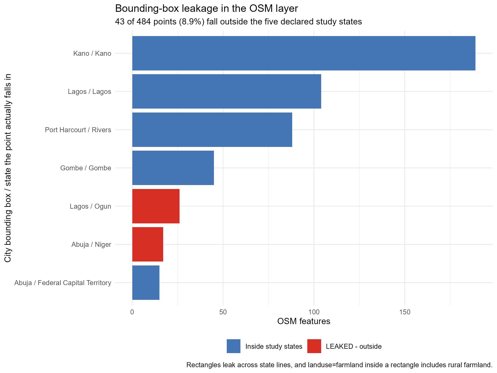
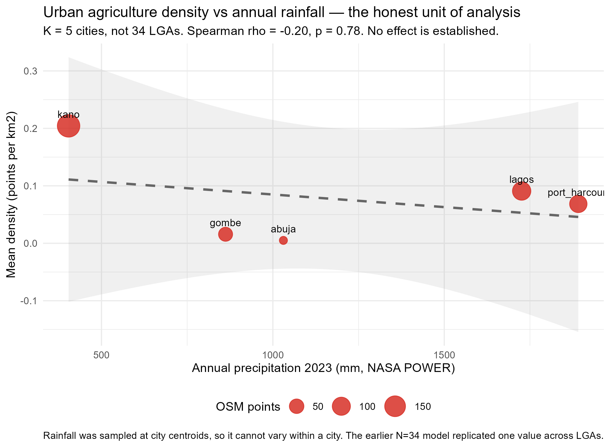

This file supports the article *Where urban agriculture concentrates in Nigerian cities: A
spatial analysis with coverage correction*. Every number here also appears in the main text. The
tables and figures are supplementary because the article is limited to six display elements, not
because the material is marginal.

```{r setup}
#| include: false
knitr::opts_chunk$set(echo = FALSE, warning = FALSE, message = FALSE)
library(sf); library(dplyr); library(readr); library(ggplot2)
library(spdep); library(MASS)

lga <- st_read("../results/lga_lisa.gpkg", quiet = TRUE)
lga$log_area <- log(lga$area_km2)
osm <- read_csv("../data/raw/osm_urban_ag.csv", show_col_types = FALSE)
```

# Table S1. The analysis frame

```{r s1}
tibble::tibble(
  Quantity = c("Local Government Areas", "LGAs containing ≥1 feature",
               "Share of LGAs with any feature", "Features in total",
               "LGAs with density exactly zero", "Median LGA area",
               "LGA area range", "Density range", "Point reconciliation"),
  Value = c(format(nrow(lga), big.mark = ","),
            sprintf("%d (%.1f%%)", sum(lga$n > 0), 100 * mean(lga$n > 0)),
            sprintf("%.1f%%", 100 * mean(lga$n > 0)),
            format(sum(lga$n), big.mark = ","),
            sprintf("%d (%.1f%%)", sum(lga$density == 0), 100 * mean(lga$density == 0)),
            sprintf("%.0f km²", median(lga$area_km2)),
            sprintf("%.1f – %s km²", min(lga$area_km2), format(round(max(lga$area_km2)), big.mark = ",")),
            sprintf("%.3f – %.3f km⁻²", min(lga$density), max(lga$density)),
            sprintf("%d of 484 features assigned", sum(lga$n)))
) |> knitr::kable(caption = "The analysis frame. The final row confirms every feature reconciles to exactly one LGA.")
```

# Table S2. Feature types

```{r s2}
osm |>
  mutate(kind = ifelse(!is.na(landuse) & landuse != "", landuse, leisure)) |>
  count(kind, sort = TRUE, name = "Features") |>
  mutate(Share = sprintf("%.1f%%", 100 * Features / sum(Features))) |>
  knitr::kable(caption = "Feature types. Only five features are formally designated allotments.")
```

# Table S3. Features by city

```{r s3}
osm |> count(city, sort = TRUE, name = "Features") |>
  mutate(Share = sprintf("%.1f%%", 100 * Features / sum(Features))) |>
  knitr::kable(caption = "Features by city. Kano alone holds 39% of all features.")
```

# Figure S1. Bounding-box leakage



# Figure S2. Distribution of density

```{r s4, fig.height=3.4, fig.width=9, fig.cap="Distribution of urban agriculture density across 775 LGAs: a spike at zero with a long right tail."}
ggplot(lga, aes(x = density)) +
  geom_histogram(bins = 60, fill = "#4575b4", colour = "white", linewidth = 0.1) +
  labs(x = "Density (features per km²)", y = "LGAs") +
  theme_minimal(base_size = 11) +
  annotate("text", x = 0.35, y = 300,
           label = sprintf("95%% of LGAs = exactly zero\nskewness = 15.5\nmax = %.2f per km2", max(lga$density)),
           hjust = 0, size = 3.4, colour = "grey25")
```

# Table S4. Local clustering before and after multiplicity control

```{r s5}
nb_q <- poly2nb(lga, queen = TRUE); lw_q <- nb2listw(nb_q, style = "W", zero.policy = TRUE)
lm_res <- localmoran(lga$density, lw_q, zero.policy = TRUE)
p_raw <- lm_res[, 5]; p_bh <- p.adjust(p_raw, method = "BH")
tibble::tibble(
  Criterion = c("Raw p < 0.05, uncorrected", "Benjamini–Hochberg FDR 5%", "Bonferroni",
                "Expected false positives at α = 0.05"),
  LGAs = c(sum(p_raw < 0.05), sum(p_bh < 0.05), sum(p.adjust(p_raw, "bonferroni") < 0.05),
           sprintf("%.1f", 0.05 * length(p_raw)))
) |> knitr::kable(caption = "Local clustering before and after multiplicity control.")
```

# Figure S3. Features across the five study cities


# Table S5. The scale coefficient in interpretable units

```{r s6}
nb_rate  <- glm.nb(n ~ offset(log(area_km2)), data = lga)
nb_slope <- glm.nb(n ~ log_area + offset(log(area_km2)), data = lga)
co <- summary(nb_slope)$coefficients
b <- co["log_area", 1]
tibble::tibble(
  Expression = c("Per e-fold increase in area", "Per doubling of area", "Per tenfold increase"),
  `Rate ratio` = round(c(exp(b), 2^b, 10^b), 3),
  `Change in density` = sprintf("%.0f%%", 100 * (1 - c(exp(b), 2^b, 10^b)))
) |> knitr::kable(caption = "The same coefficient expressed in interpretable units.")
```

# Table S6. The coverage confound, quantified

```{r s7}
expo <- read_csv("../data/raw/osm_exposure_by_lga.csv", show_col_types = FALSE) |>
  filter(!is.na(n_buildings), n_buildings > 0)
d <- lga |>
  left_join(transmute(expo, GID_2 = gid2, n_buildings, n_highways), by = "GID_2") |>
  filter(!is.na(n_buildings), n_buildings > 0) |> mutate(log_bldg = log(n_buildings))
tibble::tibble(
  Comparison = c("Features vs mapped buildings", "Features vs mapped highways",
                 "Median mapped buildings, LGAs with features",
                 "Median mapped buildings, LGAs without"),
  Value = c(sprintf("ρ = %.3f (p = %.1g)", cor(d$n, d$n_buildings, method = "spearman"), 1.9e-4),
            sprintf("ρ = %.3f (p = %.1g)", cor(d$n, d$n_highways, method = "spearman"), 2.5e-9),
            format(median(d$n_buildings[d$n > 0]), big.mark = ","),
            format(median(d$n_buildings[d$n == 0]), big.mark = ","))
) |> knitr::kable(caption = "The coverage confound, quantified. LGAs with cultivation have nearly twice the mapped buildings of those without.")
```

# Table S7. The climate diagnostic

```{r s8}
nasa <- read_csv("../data/processed/nasa_annual.csv", show_col_types = FALSE)
map <- c("Federal Capital Territory" = "abuja", "Lagos" = "lagos", "Kano" = "kano",
         "Rivers" = "port_harcourt", "Gombe" = "gombe")
dat <- lga |> mutate(city_key = unname(map[NAME_1])) |>
  left_join(nasa, by = c("city_key" = "city")) |>
  filter(n > 0, !is.na(prectot_sum)) |> st_drop_geometry()
city <- dat |> group_by(city_key) |>
  summarise(density = mean(density), rain = mean(prectot_sum), .groups = "drop")
mc <- lm(density ~ rain, data = city)
tibble::tibble(
  Quantity = c("LGAs assigned a rainfall value", "Distinct rainfall values",
               "R² of rainfall on city dummies", "Rainfall effect, treating LGAs as independent",
               "Rainfall effect, collapsed to cities (K = 5)"),
  Value = c(nrow(dat), length(unique(round(dat$prectot_sum))), "1.000",
            "p = 0.018 (spatial error model)",
            sprintf("p = %.3f", summary(mc)$coefficients["rain", 4]))
) |> knitr::kable(caption = "Why the climate hypothesis is not reported as a finding.")
```

# Figure S4. The climate question at the honest unit of analysis


